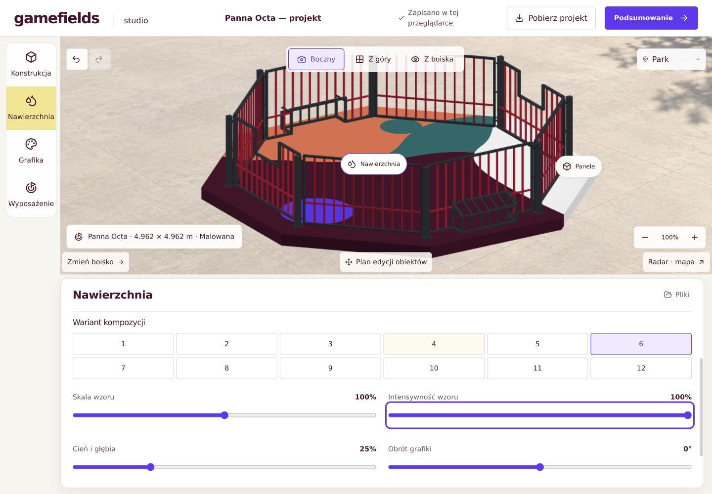
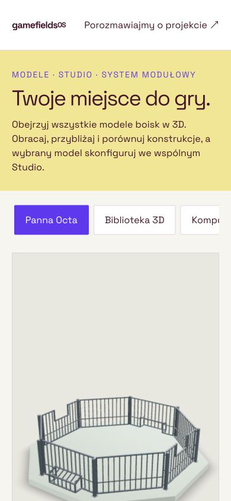
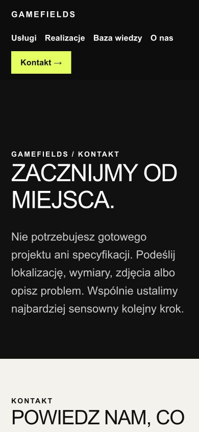
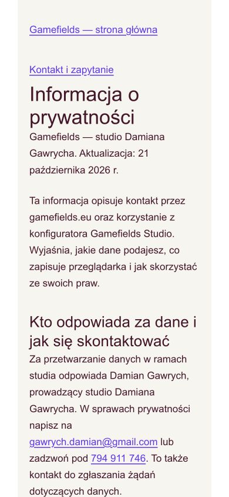
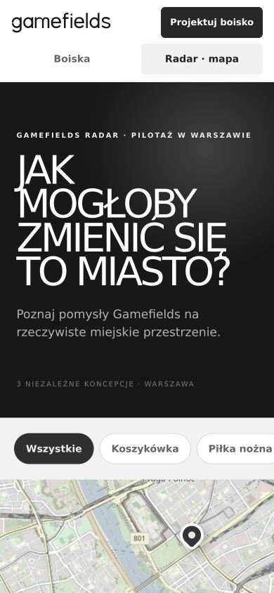

# Gamefields — audyt i wdrożenie poprawek

21 października 2026. Zakres: główna strona, katalog i porównanie, Studio, podglądy OS, Radar, kontakt i prywatność. Źródła 16 głównych stron WordPress oraz bieżące widoki na komputerze i telefonie. Nie jest to przegląd każdej historycznej strony WordPress.

## Przebieg i wynik

1. **Strona główna — czytelna, wydajność wymaga pracy.** Menu mobilne otwiera i zamyka nawigację. Formularz zachowuje pola opcjonalne. Lighthouse mobile: wydajność 57/100, dostępność 100, dobre praktyki 100, SEO 100. LCP 3,3s, TBT 1310ms, CLS 0,086, transfer 4972KiB. Brak danych CrUX. Wyniki automatyczne nie oznaczają pełnej zgodności dostępności. Dowód:03-home-desktop-before.png.
2. **Katalog — poprawiony.** Filtr Okrąg zawęża8 modeli do4; Wszystkie przywraca8. Specyfikacje i opisy powiększono do 16 px, kody do 14 px. Tabela porównawcza zachowuje przewijanie i semantykę. Dowody:01-catalog-before.png,02-catalog-filter-before.png.
3. **Studio / Nawierzchnia — poprawione i opublikowane.** Warianty, skala, intensywność, cień, obrót i logo są razem z nawierzchnią. Grafika służy do zarządzania obiektami i ma skrót do ustawień nawierzchni. Podgląd i panel mają osobne obszary. Teksty pól 16 px, etykiety 14 px; główne kontrolki 44 px. Powiadomienie zapisu nie zasłania suwaków. Dowody:18-studio-controls-after.png,20-studio-mobile-after.png.
4. **Zapis projektu i obsługa — sprawne w regresji.** JSON zachowuje wariant, suwaki i logo; import odtwarza projekt, trzy kamery działają. Undo/Redo, własne nazwy, podsumowanie, izolacja dialogu i powrót fokusu przeszły testy. Zachowano300 wzorów i 19 palet.
5. **OS / modele3D — poprawione na telefonie.** Dawne 13 przycisków w wielu wierszach spychało model poniżej ekranu. Pasek jest teraz przewijany poziomo, aktywny model automatycznie mieści się w pasku bez przewijania dokumentu. Pomiar 390 px: szerokość dokumentu 390 px, scrollY 0, aktywna Panna Octa widoczna. Dowody:11-os-mobile-audit.png,15-os-mobile-after.png.
6. **Radar — sprawny, język ujednolicony.** Filtr Piłka nożna pokazuje Plac Defilad; przejście do koncepcji i powrót działają. Przetłumaczono nagłówki, filtry, linki i szczegóły. Koncepcje nadal wyraźnie opisano jako niezależne materiały demonstracyjne. Filtry powiększono z 10 do 14 px i z 34 do 44 px wysokości. Dowody:12-radar-before.png,13-radar-detail-before.png,25-radar-mobile-final.png oraz test radar-polish-smoke.
7. **Podstrony oferty i kontakt — poprawione.** Nagłówki na czarnym tle dziedziczą właściwy kolor, menu mobilne zawija się zamiast ucinać linki, linki mają 16 px i cele 44 px. Naprawiono odnośniki do nieistniejących sekcji i CTA Opisz projekt. Demonstracyjny obraz pakowania kartonów zastąpiono wizualizacją Gamefields z podpisem. Dowody:06-contact-page-before.png,09-cities-mobile-before.png,10-contact-mobile-after.png.
8. **Formularz — poprawiony i sprawdzony bez wysyłania.** Usunięto ujemny margines motywu: na 390 px pola zaczynają się 20 px od krawędzi, dokument nie przepełnia ekranu. Pola mają16px, informacja o danych 14 px. Wymagany e-mail oznacza konfiguracja CF7; nie wykonywano rzeczywistego wysłania ani testu doręczenia. Dowody:14-contact-form-mobile.png,19-contact-form-mobile-after.png.
9. **Prywatność — usunięty błąd404, treść częściowa.** Opublikowano Informację o prywatności pod dotychczasowym adresem /polityka-prywatnosci/. Dane zgodnie z dyspozycją właściciela: studio Damiana Gawrycha,794911746,gawrych.damian@gmail.com. Opisano potwierdzone funkcje i prawa. Dokument jawnie wskazuje, że zestawienie infrastruktury, cookies i transferów wymaga uzupełnienia; nie przedstawiamy go jako zamkniętego audytu RODO. Dowody:05-privacy-before.png,17-privacy-after.png. Pełna checklista:privacy-policy-draft.html.

## Dowody najważniejszych zmian

## Publikacja i testy

Istniejące Studio: https://gamefields-studio.ryhfs90.chatgpt.site/ — wersja 70, źródło7099a41da2704339ff0c1d2f28200fedcdb0330c, publikacja succeeded. Integracja WordPress korzysta z tego samego hosta.

PASS: new-blender-arenas (5 modeli, 390/1440, kolory, 20 cm, JSON, trzy kamery, WebGL), TypeScript, test:studio, produkcyjny build, pełne test:mobile (96 konfiguracji Panna Play/Court,48 Street,16 zmian materiałów,JSON,Radar), studio-surface-readability (375/390/430/810/1024/1440 oraz844×390), radar-polish-smoke (390/810/1440), studio-usability (375/390/430/1440). Kontrolki sprawdzono także przez hit-testing; nie wystarczyła sama obecność w DOM.

Źródła i potwierdzenia zmian WordPress: wordpress-before/ i wordpress-after/. Nie usuwano danych klientów, historycznych modeli ani stron demonstracyjnych.

## Pozostałe działania według priorytetu

- P1: uzupełnić infrastrukturę prywatności, faktyczny pomiar cookies i działanie zgód, adres administratora oraz podstawy ewentualnych transferów.
- P1: odchudzić zasoby WordPress na stronach oferty. Pomiar wskazał niewykorzystywany CSS164KiB, JavaScript86KiB i1,8s wykonywania JS. Nie wyłączano wtyczek globalnie bez sprawdzenia ich zależności.
- P2: przetestować200% powiększenia, fizyczne telefony i czytnik ekranu; przeprowadzić badanie z klientami i test doręczania formularza w uzgodnionym trybie.
- P2: przejrzeć historyczne Sample Page, placeholdery i /elements/ pod kątem ruchu, indeksacji i przekierowań przed wycofaniem.

## Podstawa kryteriów

Publiczne badania Baymard i Tylko zastosowano jako wskazówki, bez deklaracji certyfikacji: [Baymard — zakładki i akordeony](https://baymard.com/research-articles/accordion-and-tab-design), [Baymard — próbki kolorów](https://baymard.com/research-articles/mobile-interactive-color-swatches), [Tylko — konfigurator](https://tylko.com/en-uk/faq/articles/customisation/what-is-the-configurator).

Normatywne kryteria: [W3C — kontrast](https://www.w3.org/WAI/WCAG22/Understanding/contrast-minimum.html), [W3C — powiększanie tekstu](https://www.w3.org/WAI/WCAG22/Understanding/resize-text.html), [W3C — minimalny cel](https://www.w3.org/WAI/WCAG22/Understanding/target-size-minimum.html).44 px jest celem projektowym, a WCAG2.2AA określa 24 px z wyjątkami. Treść prywatności oparto na [RODO](https://eur-lex.europa.eu/eli/reg/2016/679/oj?locale=PL) i [UODO](https://uodo.gov.pl/pl/493/4098).

Granice: to audyt ekspercki i testy techniczne, bez badań konwersji, pełnego badania dostępności i pełnej analizy prawnej. Wyniki Lighthouse dotyczą jednej strony i jednego pomiaru laboratoryjnego. Zrzuty zapisano w bieżącym przebiegu audytu20–21 października 2026.
