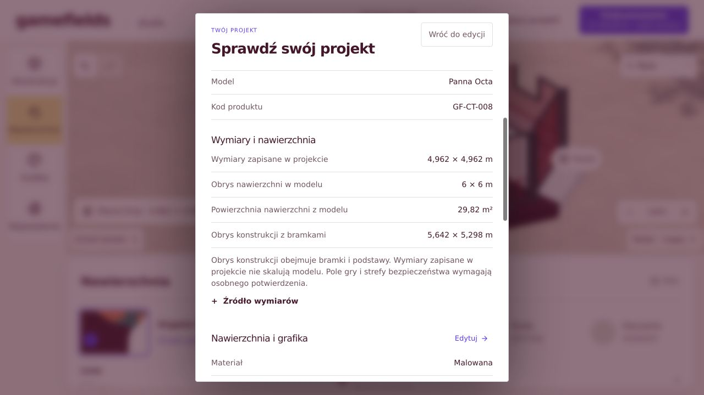
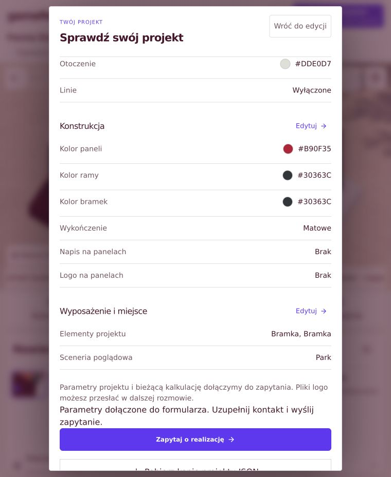
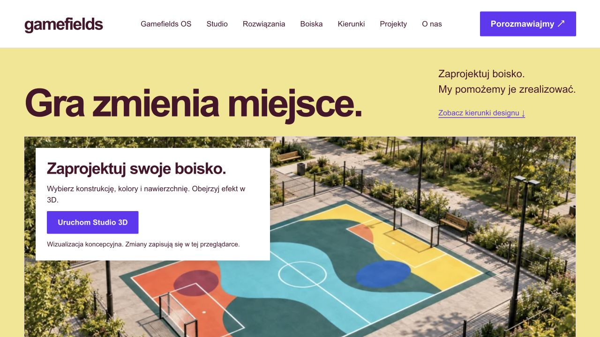
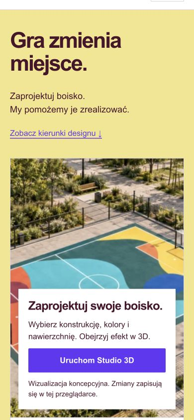
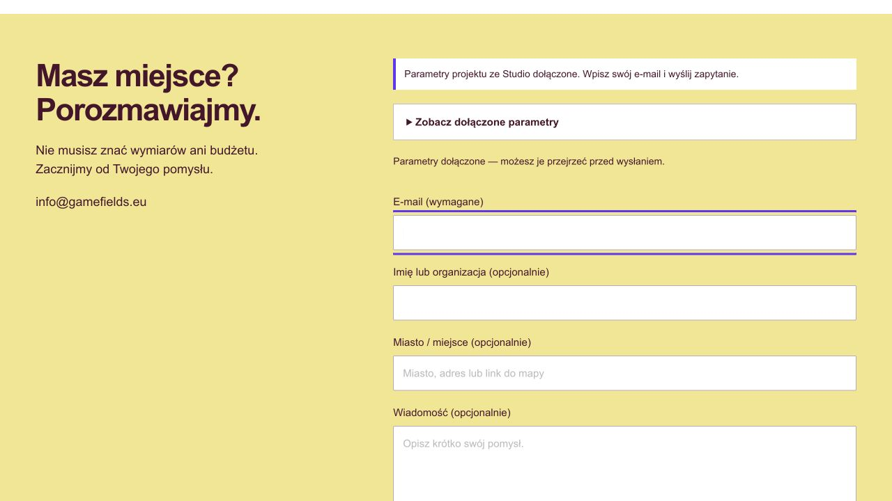
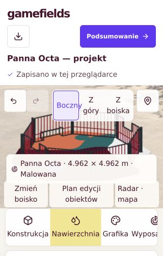
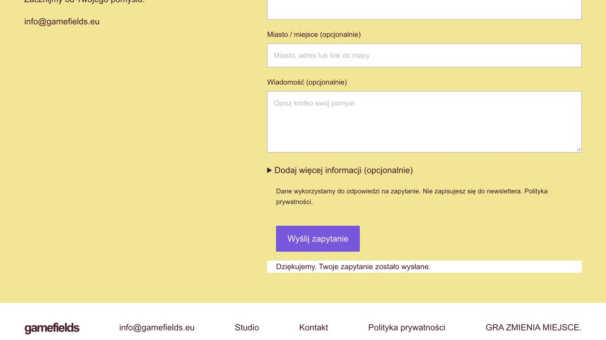

# Gamefields — realizacja zaleceń po audycie

## 25.10.2026 — Studio99: główny podgląd i miniatura konstrukcji

Wejście w Konstrukcję lub katalog boisk zamyka plan edycji i przywraca model 3D. Przycisk Zmień boisko pokazuje od razu miniaturę stalowej konstrukcji z katalogu, bez czekania na zrzut canvasu; archiwalny W1 zachowuje swój zrzut. Dla samej nawierzchni wyświetla się oznaczony podgląd Street Arena 15 (15 ×10 m), bez automatycznego przypisania konstrukcji do JSON lub ceny. Dodanie zgodnej konstrukcji lub wybór kompletnego boiska pozostaje jawny. Powrót do Nawierzchni pokazuje rzeczywisty projekt.

Na telefonie Konstrukcja ma większy główny obszar modelu nad przewijanym panelem. Obejrzano zrzuty390/1440 i poprawiono konflikt wcześniejszego układu198px w studio-readability.css. PASS: TypeScript, test:studio, build, mobile375/390/430/1440 (materiały, JSON, Radar, powrót plan→Konstrukcja),16 przypadków nawierzchni z kontrolą niezmienności projektu przy podglądzie oraz końcowa kontrola kadru390/1440. Pierwszy nowy test klikał ukryty mobilny przycisk planu w Konstrukcji; poprawiono scenariusz na otwarcie planu z Nawierzchni. Bez zmian geometrii, cen lub sekretów kosztowych.

Publikacja Studio99: źródło `8a983243ed5afdb2a55ea44eb87778d1c3f5e222`, wdrożenie `appgdep_6addff05a23c8191ad1d26212f03fb05` succeeded, env6. 

## 24.10.2026 — Studio98: nawierzchnie w Nawierzchni, konstrukcje stalowe w Konstrukcji

Na polecenie właściciela przeniesiono katalog ośmiu nawierzchni sportowych, ich wymiary oraz pliki Blender/GLB do panelu Nawierzchnia, przed wzorem, kolorami, liniami i materiałem. Wybór formatu i zamknięcie katalogu wracają do Nawierzchni; nawigacja utrzymuje aktywne narzędzie. Konstrukcja zawiera wybór siedmiu stalowych modeli, zgodne dołączanie/odłączanie, kolory i rozbudowę. Usunięto z niej selektor nawierzchni. Stałe formaty nie pokazują ręcznej zmiany niezgodnych wymiarów w katalogu konstrukcji. Przycisk Panele działa także przy konstrukcji dołączonej do osobnej nawierzchni.

PASS: TypeScript, test:studio, build, test:mobile375/390/430/1440 z materiałami/JSON/Radarem oraz 16 przypadków nawierzchni (8 sportów ×390/1440) z kontrolą właściwego panelu po wyborze i braku selektora w Konstrukcji. Geometria, formaty Project, ceny i prywatność kosztów pozostają bez zmian. Publikacja Studio98: źródło `329b40cd513adc6a772f19007da1386bee5cbc4e`, wdrożenie `appgdep_6adcae5a0ed48191a025e749d1ba0ab3` succeeded, env6.

## 24.10.2026 — Studio97: osiem niezależnych nawierzchni 20 cm

Właściciel zatwierdził zestaw: Street Football 3×3, koszykówka 3×3 i pełna, tenis, padel, siatkówka, pickleball, futsal. Powstało osiem modeli GLB i osiem scen Blender, osobne od konstrukcji, z UV góry i neutralnymi krawędziami. W Konstrukcji jest odrębny katalog nawierzchni z miniaturami; dotychczasowy wybór konstrukcji ma siedem kart. Street Football 3×3 przeniesiono do nawierzchni. Pole gry i cały obrys z przyjętymi wybiegami pokazano oddzielnie. Wspólny model 3D pozwala zmieniać wzór, kolory i linie.

Street Football 3×3 dołącza/odłącza samą Street Arena 15 bez starej murawy/fundamentu wizualnego. Pozostałe formaty jawnie wskazują brak dopasowanej konstrukcji; nie skalujemy obcych części. Stare projekty bez surfaceModel zachowują swoją geometrię. Nowe pole jest objęte walidacją, JSON, odzyskiwaniem, rewizjami wariantów i specyfikacją; ilość nawierzchni liczy całą płytę, bez ceny konstrukcji przy samej nawierzchni. Koszty i marża pozostają sekretami serwera.

PASS: tsc, build, test:studio, geometria/izolacja GLB i grubość wszystkich ośmiu modeli, niezgodne wymiary/rodziny/moduły, ceny powierzchni, rewizje, 16 przypadków 3D (8 sportów ×390/1440), dołączanie/odłączanie, kolory, JSON i odzyskanie Futsalu, mobile375/390/430/1440 z O1/P1/materiałami/Radarem, API sales-only. Kontrola wizualna poprawiła dopasowanie tekstur do podłużnych płyt. Modele 20 cm są koncepcyjne; nie zatwierdzają technologii, stref konkretnej ligi, obudowy padla ani BOM wykonawczego. Dalsze: własne dedykowane konstrukcje dla pozostałych sportów oraz zatwierdzenie technologii i lokalizacji.

Publikacja: Studio97; źródło `05742e11417ce81c07b141fc8c8955564a3834a2`; wdrożenie `appgdep_6adc9a1434ac819189a14f5c498ca80a` succeeded, env6. Paczka `sha256:69856207b54e14d6b65e193b784d35bb49c55e9a62abae0f2994d781e1647e7b`. [Wymiary, źródła i ograniczenia](https://github.com/DamianRyh/gamefields-os/blob/main/integrations/studio/canvas-editor/docs/SPORT_SURFACES_2026_10_24.md). Pliki modeli: integrations/studio/canvas-editor/public/sport-surfaces/. Nie powstało nowe miejsce edytora.

## 24.10.2026 — Studio96: miniatury konstrukcji w kartach wyboru

Karty „Wybierz boisko” pokazują nad nazwą, ceną i wymiarami rendery siedmiu własnych konstrukcji. Obrazy WebP 640×400 w tej samej perspektywie ważą łącznie około 130 kB; karty nie tworzą dodatkowych kontekstów WebGL. Generic Street Football 3×3 ma odrębną ilustrację i opis „Projekt nawierzchni”. Zachowano osiem kart, aktywne zaznaczenie, ceny sprzedaży i powrót do Konstrukcji po wyborze.

Źródła i hashe: `public/arenas/thumbnails/manifest.json`. Odtworzenie: `node scripts/build-construction-thumbnails.mjs`. Panel wyboru ma większy obszar na komputerze, bez nakładania się na podgląd. Geometria, modele, szkice, moduły i prywatność kosztów pozostają bez zmian.

Walidacja: tsc, test:studio, build i test:mobile; wszystkie osiem miniatur dekoduje się na 375/390/430/1440 px, wybór boiska działa, brak dodatkowych canvasów w kartach i poziomego przewijania. Publikacja Studio96: źródło `49295e03d22aee00080b11c38a4e0266d14eed1a`; wdrożenie `appgdep_6adc718e760081918411d06d07ec297e` succeeded, env revision 6.

## 24.10.2026 — Studio95: Konstrukcja jak Nawierzchnia

Panel Konstrukcja ma wspólny z Nawierzchnią układ: miniatura bieżącego modelu 3D, nazwa boiska i „Zmień boisko”, obok kolory Bandy/Rama/Bramki. Miniatura korzysta z istniejącego canvasu, bez dodatkowego WebGL i bez zmiany danych projektu. Wybór modelu i anulowanie wracają do Konstrukcji. Rozbudowa pozostaje w tym panelu, w rozwijanej sekcji otwieranej także przyciskiem Budowanie modułowe.

Usunięto przycisk zmiany boiska spod sceny. Etykieta modelu na podglądzie jest nieklikalna. W Studio jedyne „Zmień boisko” znajduje się w Konstrukcji. Zachowano moduły, kolory, nawierzchnie, grafikę, szkice i prywatność kosztów.

Sprawdzenie: tsc, test:studio, build, test:mobile (4 szerokości, materiały/JSON/Radar), 8 przypadków panelu P1/O1 × 4 szerokości (miniatura, trzy kolory, jedyny wybór w panelu), 8 przypadków wspólnego edytora modułów. Publikacja Studio95: źródło `f3136d8cbb0924adcc51baff227527167b2f64be`, wdrożenie `appgdep_6adc5f1d348881919a0e4c6f85a39023` succeeded, env revision 6.

## 24.10.2026 — Studio94: naprawiona geometria i wspólny edytor

Zastępuje oddzielny edytor ze Studio93. Rozbudowa odbywa się w panelu Konstrukcja przy tym samym modelu 3D co kolory band/ramy/bramek, logo/tekst i grafiki nawierzchni. Parametry są zapisane w Project.modular (GF-STUDIO-MODULAR-2): wspólny szkic, Cofnij/Ponów, JSON, specyfikacja, warianty i A/B. Studio nie otwiera dodatkowego okna ani iframe.

Poprawiono znak obrotu paneli Panna Octa oraz krótkich paneli i bramek Panna Grid. Panele Octagonu dochodzą do słupków; bramki wystają na zewnątrz. Oryginalne GLB zachowują wymiary 1:1. Jedna rodzina na konfigurację. Panna Grid zwiększa długość/szerokość; Panna Cage 90/180 zmienia poziomy; Panna Octa ma stały obrys. P1/O1/W1/Street15 pozostają modelami bazowymi bez niepotwierdzonego układu modułów.

Nawierzchnia 20 cm i jej ilość wynikają z aktualnego obrysu modułów. Konstrukcja oraz jej montaż pozostają do wyceny; cena modelu bazowego nie jest stosowana do konfiguracji modułowej. Koszty produkcji pozostają sekretami serwera. BOM wykonawczy, połączenia i kotwienie nadal niezatwierdzone. Stary silnik inspektora OS i dane historyczne zachowano; adapter Studio ma własną przypiętą rewizję źródeł.

Walidacja: 243 układy (orientacja bramek, końce paneli Octagonu przy słupkach, rodzina/skala), hashe GLB i kodu, schemat/JSON/rewizje wariantów, powierzchnia i częściowa wycena; tsc, test:studio, build, test:mobile (4 szerokości i Radar), API sales-only. Przeglądarka: cztery modele × 390/1440 px (moduły + kolory + nawierzchnia, obrót, Cofnij/Ponów, szkic po ponownym otwarciu, JSON i brak ceny bazowej). Modułowe A/B 375/1440 px z logo/tekstem i ochroną starej rewizji.

Publikacja: Studio94; źródło `587c16ecd1d586a48d823c73d8db8f03de868e5b`; wdrożenie `appgdep_6adc5a61c3d48191a82616861eefa2b5` succeeded, env revision 6. Dalszy zakres: zatwierdzone połączenia/BOM/kotwienie i stawki konkretnych modułów, nie nowe miejsca edytora.

## 24.10.2026 — Studio93: spójne kolory i edytor modułów

Opublikowano jeden obracany podgląd 3D (również A/B), bez przycisków Boczny/Z góry. Bandy, Rama i Bramki używają kontrolek i typografii nawierzchni. Przycisk Budowanie modułowe otwiera w Studio lokalny silnik OS z oryginalnymi GLB: Panna Grid (Street Field) zwiększa długość/szerokość, Circle Cage zmienia poziomy, Octagon ma stały obrys. Konfiguracja pozostaje w jednej rodzinie i zachowuje skalę części 1:1.

Edytor modułowy ma osobny szkic w przeglądarce, import/eksport GF-OWNED-ASSEMBLY-1 i osobną wycenę. Nie modyfikuje projektu, nawierzchni ani wyceny Studio. Integracja jego geometrii z grafiką i kalkulacją Studio pozostaje dalszym etapem. Nie rozszerzono P1 bez potwierdzonego podziału modułów. Nie potwierdzono BOM wykonawczego, kotew ani fundamentów. Koszty produkcji nadal pozostają tajne po stronie serwera.

Walidacja: tsc, test:studio, build, test:mobile (4 szerokości, materiały/import/Radar), orbitowanie 8 modeli × 2 szerokości, porównanie A/B 375/1440, edytor modułowy 390/1440 (3 rodziny, wzrost instancji, skala 1:1, eksport/import/odzyskiwanie). Publikacja: Studio93, źródło `75937b2f5c08116049871111a3f4900e3d0b68ca`, wdrożenie `appgdep_6adc529484c081919ed37fc45f982b1a` succeeded, env revision 6. 

## 24.10.2026 — Studio92, uproszczony edytor

Wdrożono cztery korekty wskazane przez właściciela: wyposażenie wyłączone; czytelniejsze grupy kolorów Bandy/Rama/Bramki; Boczny/Z góry/obracany Model3D zamiast Z boiska; brak selektora scenerii i neutralne tło w Studio. Modele i zdjęcia do wykorzystania poza Studio zachowano; nie dodawano teraz nowej sekcji strony głównej.

Dostępne narzędzia: Konstrukcja, Nawierzchnia, Grafika. Starsze wyposażenie pozostaje w pełnym JSON/IndexedDB, lecz jest pomijane w podglądzie, aktywnym zapytaniu/specyfikacji i wycenie (również w API). Bramki stanowiące część własnej konstrukcji pozostają. Nowe projekty nie otrzymują swobodnego wyposażenia.

Model3D obraca się myszą, dotykiem lub strzałkami; Home/przycisk resetuje kąt. Zmiany nawierzchni, materiałów i oznaczeń zachowują obrót. Kamera nie zmienia Project ani nie regeneruje tekstur podczas drag. Kadr dopasowuje się do gabarytów i proporcji canvasu. W1 nadal tylko jako archiwalny import; projekt bez własnej geometrii zachowuje Boczny/Z góry, a obrót3D jest niedostępny z objaśnieniem. A/B używa tych samych trybów i neutralnego tła.

PASS: TypeScript/build, test:studio, test API (brak opłaty za wyłączone wyposażenie, koszty nadal ukryte),80kombinacji kadru;16przypadków obrotu8modeli przy375/1440px; rzeczywisty emulowany gest dotykowy390px; warianty A/B375/1440;24widokiO1/P1+8neutralnychStreet+16materiałówP1, JSON/szkic i Radar na4szerokościach. Nie utrzymujemy historycznej liczby96scen po celowym usunięciu scenerii. Zrzuty375/1440/390 obejrzano; poprawiono pozostałość tła i mobilną podpowiedź. Kontrola produkcyjna również PASS. [Szczegóły](https://github.com/DamianRyh/gamefields-os/blob/main/integrations/studio/canvas-editor/docs/STUDIO_UX_2026_10_24.md), dowody tools/studio-ux-2026-10-24/.

Źródło c299cbb7b7ddcf5212641f574b9b6bb0db45044a; wersja92 appgprj_6abbd0ba26f0819197701343bf156f1b~appgver_aeccdbffbdb0819187716289ffd49f0b; deployment appgdep_6adc4c0eeb4081919ff69c835a1ce973 succeeded, env6 bez zmian. Hash natywny sha256:3751e89430e249c4385dbf6f1c3e6671422a7f22dd545bb5efdd397ec28c65db. Publikacja w dotychczasowym osadzeniu konfiguratora; nie powstało nowe miejsce. Ceny sprzedaży, sekrety kosztowe, geometria, schemat Project i SQL zachowane. Dane wykonawcze i testy na fizycznych urządzeniach mają wcześniejsze ograniczenia.

## 24.10.2026 — Studio91, koszty wewnętrzne i ceny sprzedaży

Decyzja właściciela: dotychczasowe kwoty są kosztami produkcji i nie mogą być przedstawiane klientowi jako cena sprzedaży. Zastępuje wcześniejsze wyprowadzenie kosztu z ceny referencyjnej. Koszt i parametr marży są sekretami serwera, a odpowiedź API jest budowana z nowej, ograniczonej karty sprzedaży. Nie kopiuje kosztowych opisów, identyfikatora cennika, marży ani nieznanych metadanych. Brak poprawnej konfiguracji nie uruchamia fallbacku na koszt. Klient/porównanie/zapytanie otrzymują wyłącznie kwoty sprzedażowe.

Cztery dawne pliki z pricing/ przeniesiono do biblioteki wewnętrznej; publiczne testy używają sztucznych stawek. Nowa wersja i bieżące raporty nie publikują tych tabel. Starsze rewizje, wydania i wcześniej pobrane kopie mogą nadal zawierać dane opublikowane przed przeklasyfikowaniem; nie przepisano historii Git ani nie deklaruje się cofnięcia wcześniejszej publikacji.

PASS: TypeScript/build, test:studio, API zbudowanego Workera (sprzedaż zamiast kosztu, brak metadanych, błędna/brakująca marża, ignorowanie starego QUOTE_RATE_CARD), kalkulacja marży, fikcyjne192kombinacje, paleta i warianty375/1440, pełna regresja96O1/P1+48Street+16materiałów/JSON/Radar na4szerokościach. Produkcyjny POST HTTP200 odpowiada lokalnej kalkulacji sprzedaży; osiem cen konstrukcji różni się od kosztów, brak kosztowej wersji i wewnętrznych pól, brak domyślnego VAT. Dowód bez kwot: tools/sales-privacy-2026-10-24/production-proof.json.

Źródło c5ac0b93bd0d258d4792558fc5224a506c92d133; wersja91 appgprj_6abbd0ba26f0819197701343bf156f1b~appgver_9535d30b79b48191a222f08aa1499e58. Deployment appgdep_6adc3cfeaea4819190227b3805a8e791 succeeded, env6. Archiwum natywne sha256:6a1cdd9be0ff3fd4a70e1b1e9d500155a16fe175844daf6cfaf434a0f2a92ee8. Istniejący konfigurator WordPress osadza to samo Studio. Odczytano stronę główną, ofertę street-football i OS/P1; w zwróconym HTML nie znaleziono badanych dawnych kwot. Nie oznacza to audytu każdej historycznej podstrony lub kopii.

[Zasady i ograniczenia](https://github.com/DamianRyh/gamefields-os/blob/main/integrations/studio/canvas-editor/docs/SALES_PRICE_PRIVACY.md). Geometria, Project/IndexedDB i SQL bez zmian; zatwierdzenia techniczne, kotwienie/fundamenty i VAT nadal pozostają odrębnymi zależnościami.

## 23.10.2026 — odczyt projektu konstrukcji, bez zmiany wdrożenia90

Przejrzano dostarczony 30-stronicowy projekt konstrukcji:24rysunki i opis trzech rodzin P1/F01,O1/F02,W1/F03. Pozostałych pięciu modeli Studio nie obejmuje. W bibliotece wewnętrznej zapisano20wierszy odczytanych ze złożeń, kandydatów mapowania articleId oraz rozbieżności dokumentu. Nie zastępują instancji aktualnego modelu Studio.

Korekta stanu braków: dane materiałowe, przekroje, część detali połączeń i stop znajdują się w projekcie. Opis wymienia kotwy mechaniczne lub szpilki wbijane dla P1/O1, lecz brak kompletnego doboru kotwienia do lokalizacji. Obecność otworów w stopie nie zatwierdza typu lub ilości kotew. Fundamenty, parametry zakupowe i zatwierdzenie współczesnej rewizji nadal niepotwierdzone. Dokument opisuje W1 jako konstrukcję do wnętrz; nie rozszerzono tego na deklarację użytkowania na zewnątrz.

Znaleziono sprzeczności w tabelach mas, datowaniu i oznaczeniach rysunków oraz rozbieżność gabarytu P1 wobec aktualnego modelu. Nie wybrano arbitralnie mas do automatycznej wyceny/kg. source evidence nie zmienia manufacturingApproved=false, connectionApproval=UNCONFIRMED ani technicalBill.rows=null dla aktualnego Studio.

Na polecenie właściciela przygotowano wewnętrzny model roboczego kosztu i marży, z jasno opisanym wyprowadzeniem kosztu z cen referencyjnych; nie jest to oferta producenta lub dowód rentowności. Pełny PDF, szczegółowy BOM i koszty nie są publikowane. Publiczne modele, osiem cen konstrukcji, środowisko i Studio90 pozostają bez zmian. Kolejny krok: wyjaśnienie sprzeczności źródła, mapowanie konkretnych rewizji oraz zatwierdzenie rzeczywistych kosztów i kotwienia.

## Aktualizacja — Studio90, 23.10.2026

Porównano pełny dostarczony Gamefields.eu.txt (kończący się na „Testy regres” w Sprincie6) z kodem i stanem Studio89. [Zestawienie wszystkich etapów i braków](https://github.com/DamianRyh/gamefields-os/blob/main/integrations/studio/canvas-editor/docs/GAMEFIELDS_EU_RECONCILIATION_2026_10_23.md).

Zamknięty zakres programistyczny z4.4: opcjonalny budżet liczby kolorów palety. Nowa karta GF-WORKING-2026-10-23-v2 zachowuje stawki v1 i8cen konstrukcji; dodaje roboczo2kolory w pakiecie i[stawka archiwalna] za dodatkowy kolor. To unikalne wejścia wybranej palety, nie pomiar widocznych pikseli ani receptura farb. UI objaśnia zależność i pokazuje osobną pozycję. Stare karty nie zmieniają wyników; Project/IndexedDB/SQL i modele zachowano. Grafika wyłączona, trawa i piasek nie dostają tej dopłaty. Otoczenie nie zwiększa budżetu warstwy Blender; linie i branding są oddzielne.

PASS: TypeScript, build, test:studio, quote-engine, stara karta192kombinacje, nowa polityka kolorów, interfejs375/1440 oraz pełna regresja96O1/P1+48Street+16materiałów, JSON/szkic i Radar na4szerokościach. TestUI potwierdził[kwota archiwalna]PLN różnicy za dodatkowy kolor dla29,82m². Produkcyjny POST /api/quote: HTTP200, pełna zgodność z lokalnym silnikiem, netto[kwota archiwalna]PLN dla utrwalonej konfiguracji, brutto/VATnull i workingAssumptions=true. Bez formularza, e-maila lub zapisuDB. [Dowód API](https://github.com/DamianRyh/gamefields-os/blob/main/tools/palette-pricing-2026-10-23/production-palette-smoke.json).

Źródło Sites: 0d87047e000e312fe52e003c3dfb475ae29e247c. Wersja90: appgprj_6abbd0ba26f0819197701343bf156f1b~appgver_5af87237bde481919fe96f9d910c303f. Deployment appgdep_6adbb5cdd4f48191852f8968834bb444 succeeded, env5. Hash natywny sha256:d6994ef414de9776215bfc2ff907445e6ec88c87cd4ad11873690b79654ce45e. Istniejący iframe /konfigurator-boisk/ wskazuje to samo Studio, więc publikacja jest dostępna na gamefields.eu; nie utworzono nowej strony ani nie przebudowano odrębnego OS.

Dalsza kolejność: zatwierdzone rewizje/instancje/połączenia i fundamenty; własne modele brakujących akcesoriów; potwierdzony cennik/receptury/VAT/warunki lokalizacji; fizyczne urządzenia/czytniki/badania i budżetSLA. Konto/chmura nadal poza obecnym lokalnym zapisem. Zależności WordPress/WPCode, fakty prywatności i odbiór poprzedniego testu poczty nie zostały ponownie potwierdzone. Cały plan pozostaje PARTIAL; poniższe wydania są historią.

## Aktualny etap — Studio89, 23.10.2026

Źródło `b4da8bcdd172c8bfb4ea01d8f7c4433e78c54a42`, wersja `appgprj_6abbd0ba26f0819197701343bf156f1b~appgver_8fc4a915fc608191866f088151097a3b`, deployment `appgdep_6adbb1cf0b4081918c2af2091da68b77` — **succeeded**, środowisko revision4. Paczka natywna `sha256:8223cbeeac4d5741336e8c8d3d9444fa6c151f941f9868464aef4609e94d2d70`.

Wdrożony zakres i granice: [PRIORITIES_2026_10_23](https://github.com/DamianRyh/gamefields-os/blob/main/integrations/studio/canvas-editor/docs/PRIORITIES_2026_10_23.md). Raporty pomiarów i kontroli: `tools/priorities-2026-10-23/`. Poniższy stan zastępuje wcześniejsze opisy aktualności; wcześniejsze wydania i pomiary pozostają historią.

- **Street Field / renderer:** końcowy profil V2 zachował trzy identyczne obrazy. Wyszukania lokalizacji uniformów1374→0 i atrybutów405→0 po rozgrzaniu; pozostałe liczniki bez zmian. Mediana tekstu491,8→410,6ms, cached327,2→329,4ms. To pięć uporządkowanych instrumentowanych powtórzeń w konkretnym harnessie, nie nowe ABBA, uniwersalne przyspieszenie, GPU/FPS lub SLA. Historyczne mieszane ABBA85/87 zachowano.
- **O1 / odzyskiwanie:** timeouty modelu/obrazów/generacji, kontrolowane błędy, ponowienie i utrata WebGL obsługiwane bez resetowania Project. Testy recovery/fault-injection PASS;40normalnych nawigacji O1 PASS. Osobny timeout obserwatora rAF przy już gotowym DOM zachowano w diagnostyce; poprawiony interwałowy harness nie dowodzi przyczyny pierwotnego historycznego przerwania ABBA.
- **Warianty3D:** porównanie A/B w jednym dodatkowym canvasie na żądanie, wspólne trzy kamery, modal/Escape/powrót fokusu i kontrola rewizji; testy PASS. Pełny Project i IndexedDB pozostają niezmienione. Brakujące własne modele3D akcesoriów oraz obiekty poza nawierzchnią są jawnie oznaczone jako widoczne tylko na planie2D; nie ukończono odwzorowania wszystkich obiektów3D.
- **Geometria / BOM:** poprawiony F04:26zarejestrowanych artykułów istnieje, potwierdzonego złożenia OS brak. Wszystkie56artykułów mają UNCONFIRMED; technicalBill.rows=null i manufacturingApproved=false. Dwa odtworzenia audytu8rewizji/25zasobów dały identyczny JSON `e47ae0f8244d1375e9c7e124ae0ee8fc9019cc4659c415ac90649aa86565efef`. Checklista i szablon wejściowy nie dobierają śrub, kotew ani fundamentów.
- **Robocze stawki:** właściciel potwierdził brak danych i polecił „podłóż wartości”. Osobna karta `GF-WORKING-2026-10-23-v1`:6nawierzchni,29typów wyposażenia z UI, montaż8konstrukcji,4poziomy grafiki, linie, branding, wykończenie, projekt i transport.8cen konstrukcji zachowano. UI/API jawnie oznaczają ROBOCZE/NIEZWERYFIKOWANE; brak VAT/brutto i zatwierdzenia handlowego.192kombinacje i przykładOcta[kwota archiwalna]netto PASS sprawdzają arytmetykę, nie rynkową poprawność cen. Wynik estimated w roboczym zakresie nie jest pełną ofertą realizacji. Nieznane dodatki nadal dają partial. [Założenia](https://github.com/DamianRyh/gamefields-os/blob/main/integrations/studio/canvas-editor/docs/WORKING_RATES.md).

Bramki końcowego wydania PASS: TypeScript, build, domenowe, pełne mobile, nowe areny i Surface,58przypadków stron Circle,84porównania rastra,60stanów tekstur, warianty3D, robocza karta i kontrolowane awarie. Produkcyjny odczyt API: HTTP200, wynik dokładnie równy lokalnej kalkulacji z rzeczywistym patternComplexity; workingAssumptions=true, wersja GF-WORKING-2026-10-23-v1, netto[kwota archiwalna]PLN, gross=null i vat=null. Dowód: `tools/priorities-2026-10-23/production-quote-smoke.json`. Kwota różni się od niezależnego przykładuOcta[kwota archiwalna], bo ten odczyt używa własnej konfiguracji i rzeczywistej złożoności wzoru. Bez zapisów DB, formularza i e-maila. Nie wysyłano kolejnego testowego zapytania.

**Nadal PARTIAL:** zatwierdzenie geometrii/R02, techniczny BOM i połączenia/kotwienie/fundamenty; własne modele3D wszystkich akcesoriów; zatwierdzony cennik, warunki lokalizacyjne i podatkowe; fizyczne urządzenia, czytniki, badania z ludźmi i budżet/SLA. Pozostają historycznie udokumentowane zależności WordPress/WPCode, fakty prywatności i potwierdzenie skrzynkowego odbioru wcześniejszego jednego maila. Nie odczytywano ich ponownie w tym wydaniu.

## Zestawienie Gamefields.eu.txt i porównanie cen — Studio88

23.10.2026: źródło `6ca9dad641b981c3119db98833a3756376ac18b2`, wersja `appgprj_6abbd0ba26f0819197701343bf156f1b~appgver_d70a0f1f38488191bce2578c2e8e1643`, deployment `appgdep_6adb72c25e748191ba77524f9a03b716` — **succeeded**, środowisko revision3. [Studio](https://gamefields-studio.ryhfs90.chatgpt.site). Paczka `sha256:513768cca99c65b09845afa68cd6b7437d0b8e3dfc7f5a23d21ec3ff5d25c984`.

**Porównano cały zakres załącznika:** etap0–4 oraz sprinty0–6, z rozdzieleniem działających funkcji, częściowych prac i brakujących danych. Dokument źródłowy ma SHA256 `af77fb6ee8bbc79d305fac5ec0bd0e139c976041343d62cc3d6d58f9750f91d2` i urywa się na „Testy regres”; nie dopisano końcówki. [Tabela zgodności](../../../product-intelligence/2026-10-21/ZESTAWIENIE_GAMEFIELDS_EU.md). Nie jest to nowy pełny benchmark konkurencji ani audyt WordPress.

**DONE — lokalne porównanie bieżących kalkulacji wariantów.** W Plikach projektu dwa zaznaczone zapisy pokazują plan2D, parametry i osobne aktualne kalkulacje, bez przywracania. Wspólny hook/API, osobny retry, zakres i pozycje Do ustalenia; stara rewizja modelu nie dostaje ceny dla nowej geometrii. Odznaczenie anuluje zapytanie, a spóźniona odpowiedź nie przywraca karty. Nie utrwalamy ceny jako oferty ani nie odejmujemy niepełnych sum jako oszczędności. Pełny Project i biblioteka niezmienione.

PASS: TypeScript, build, test:studio, quote-engine/construction-pricing, pełne test:mobile96aren/48Street/16materiałów/JSON/Radar na375/390/430/1440 i Surface7rozmiarów. Nowy test375/1440 sprawdza różne wyniki,503/retry, blokadę rewizji bez własnego zapytania, spóźnioną odpowiedź, dokładną niezmienność Project/IndexedDB i reflow. Oczekiwane kwoty z niezależnych zapytań API z jawnym testowym cennikiem TEST-NOT-FOR-SALE; fixture nie trafia do produkcji. Pierwszy test lokalny miał unpriced z braku cennika w izolowanym Workerze; dodano fixture. Poprawiono także lokalną ścieżkę uruchomienia harnessu i przechwycenie widocznego kadru. Bez zmian silnika/stawek.

**Pozostaje PARTIAL:** interaktywne porównanie3D i pełne odwzorowanie personalizacji3D, profil Street Field1440tekst i timeout O1, odzyskiwanie błędów3D, fizyczne urządzenia/dostępność, zgodność geometrii/R02, połączenia i techniczny BOM, brakujące stawki realizacji i potwierdzone leady. Nie zmieniono modeli, cennika komercyjnego, renderera, ProjectJSON, SQL lub BOM; nie wysyłano formularzy. ABBA niezmienionego renderera pozostaje dowodem historycznym85/87, nie nowym pomiarem88.

[Kontrakt](../../../../integrations/studio/canvas-editor/docs/VARIANT_PRICING.md) · [test przeglądarkowy](../../../../integrations/studio/canvas-editor/docs/variant-pricing-2026-10-23/browser.json).

## Powtarzane pomiary Studio85–87 — 23.10.2026

**DONE — lokalny zakres ABBA:** opublikowane pakiety85/87, kolejność85→87→87→85,1920próbek w96komórkach. Wszystkie48zestawów obrazów z trzech kamer identyczne RGBA we wszystkich czterech seriach. Analyzer i niezależne przeliczenie potwierdziły surowe dane, mediany/maksima, hashe i kolejność. Wspólne źródła geometrii i84pakiety JS każdej wersji sprawdzone; bez przypisywania bieżącego renderera do starego buildu.

**Wyniki mieszane:**35komórek ma obie mediany87 niższe,4wyższe,57nakładające się zakresy. Złożone przerysowanie ma niższe obie mediany w16/16komórkach, ale nie wszystkie maksima są niższe. Street Field1440tekst:85mediany474,9–480,0ms,87mediany502,2–764,8ms; maksima721,1→1775,3ms. To priorytet osobnego profilowania, nie potwierdzenie przyczyny lub braku regresji. Circle2tekst1440 pozostaje mieszany. Raport wymienia wszystkie cztery wyższe zakresy i wolne próbki.

Pierwsze ABBA przerwano po timeout45s O1/375 przy drugiej nawigacji. Zachowano pełną bazę i częściowego kandydata; cały eksperyment wyłączono z porównania. Osobna diagnostyka60operacji PASS. Dodano wyłącznie diagnostykę błędu i ponowiono wszystkie cztery serie na jednym hashu harnessu, bez zmiany aplikacji lub timeoutu. Przyczyna przerwania nadal nieustalona; późniejsze PASS nie dowodzą naprawy.

Środowisko: Apple M1, Chromium149/SwiftShader, DPR1,375/1440×1000. Mierzono zgłoszenie końcowego draw, nie prezentację GPU, FPS, sieć produkcyjną lub telefon. Dwie serie po5próbek nie wyznaczają p95, istotności lub SLA. Porównanie obejmuje łączny wpływ86+87 ponad85, nie izoluje zmian; nie łączymy wyników z historycznym81/82. Domyślne obie strony paneli. **S2-04 i S6 nadal PARTIAL.**

Publiczna aplikacja pozostaje **Studio87**, źródło `46dec70f4af0e0dc0ed3c2a95193a602ae5f3ff8`; nie utworzono88 ani nowego wdrożenia runtime. Nie powtarzano TypeScript/build/mobile dla samej dokumentacji i narzędzi; wcześniejsze bramki87 pozostają historycznym dowodem. Modele/R02, ceny, Project, SQL i BOM pozostają bez zmian. GeometryCorrespondence=UNCONFIRMED, technicalBill.rows=null.

[Wyniki i ograniczenia](../../../../tools/renderer-measurements-2026-10-23/RESULTS.md) · [protokół i odtworzenie](../../../../tools/renderer-measurements-2026-10-23/README.md) · [surowa analiza](../../../../tools/renderer-measurements-2026-10-23/results/analysis.json) · [kolejne kroki](../../../../tools/renderer-measurements-2026-10-23/NEXT_STEPS.md).

## Puste tekstury i audyt geometrii — Studio 87

23.10.2026: źródło `46dec70f4af0e0dc0ed3c2a95193a602ae5f3ff8`, wersja `appgprj_6abbd0ba26f0819197701343bf156f1b~appgver_9747874feea881918c54184f09b6c1b3`, deployment `appgdep_6adb36f5227c8191b0a596985cac5a5f` — **succeeded**, środowisko revision 3. [Studio](https://gamefields-studio.ryhfs90.chatgpt.site). Paczka `sha256:6f7db90490f7c289501abdabcdbbe5bf19cf7333555dbc94fb1ab7fb6e2e9fc4`.

**DONE — zbędne białe uploady.** Osobna flaga whiteTexture opisuje stan GPU niezależnie od klucza zadania. clearTexture zawsze najpierw unieważnia klucz, lecz pomija upload do już białej tekstury. Grafika i błąd pozostawiający wcześniejszy obraz nadal wymagają czyszczenia; flaga zmienia się dopiero po udanym uploadzie. Zachowane retry, stare/zniszczone zadania, cache PNG/Image i wspólne końcowe rysowanie.

**60/60 stanów zgodnych pikselowo z wersją86**: oba Circle Cage ×375/1440 ×both/inner/outer ×tekst/kolor/logo/usunięcie/ponowny kolor pustych paneli. Bufory geometrii/normalnych/UV, kolory, eksport design, Image load, uploady PNG i clear/drawArrays identyczne. W44 stanach mniej białych resetów. Circle2 jednostronnie tekst/kolor/logo: wszystkie uploady **32→16** (16 PNG i0zbędnych białych); usunięcie grafiki nadal wykonuje16 wymaganych białych resetów. Kolejna zmiana koloru pustych paneli daje0 zamiast16/32. Circle1 analogicznie8 paneli. To liczba zgłoszeń aplikacji, nie FPS, czas GPU lub oszczędność pamięci.

Początkowy odczyt liczników przechwycił dodatkową klatkę ResizeObserver tylko w jednej serii. Dodano stabilizację po dwóch klatkach i powtórzono obie serie: baza pochodzi z zachowanego archiwum86, a jej hashe paczek są identyczne z opublikowanym86. Nie osłabiono asercji. Pierwsza równoległa regresja mobilna zatrzymała się na kliknięciu kamery; pełne testy ponowiono sekwencyjnie. Ponowiony test błędu po wcześniejszej grafice, pustego wyglądu, retry i opóźnionego obrazu PASS375/1440.

**DONE — inwentaryzacja zgodności, bez zatwierdzenia geometrii.** Nowy deterministyczny skrypt mierzy osiem aktualnych rewizji Studio i weryfikuje ich źródła, przypięty silnik/katalog/rejestr oraz25/25 komponentów OS. Dwa uruchomienia dały identyczny JSON SHA256 `9bc4dfd3420a87d7d04bd5be1c5e4e12e848326d6ebee0b18ab7ceae986ed1ae`. Cztery rodziny źródłowe nie mają potwierdzonego złożenia OS. Deskryptor Circle ma średnicę podłoża7,1m wobec6m Studio; Grid7,31×5,304 wobec7,3×5,3. Octagon wymaga przypiętego mesha/orientacji podłoża; porównanie jego pola i obrysu pozostaje null. Różne metody pomiaru i deskryptory nie dowodzą wady wykonawczej.

Nadal geometryCorrespondence=UNCONFIRMED i manufacturingApproved=false dla wszystkich8 modeli. Do BOM wymagane zatwierdzone instancje i transformacje, mapowanie do dokładnej rewizji Studio, połączenia, rozstawy, obrysy/strefy, kotwy i fundamenty. Nie dopisano ilości OS do aktywnego Project ani ceny. Nie podmieniano modeli, R02, stawek, SQL lub formatu Project i nie wysyłano formularzy.

PASS: TypeScript, build, test:studio (w tym błędy/clear/retry/stale), quote-engine/construction-pricing,60 porównań, dwa scenariusze błędów/wyścigów, pełne test:mobile96aren/48Street/16materiałów/JSON/Radar, Surface7rozmiarów i58przypadków stron paneli. Eksperci przygotowali kod, scenariusz oraz audyt; prowadzący niezależnie porównał60par, hashe paczki86 i dwa odtworzenia audytu.

[Resety tekstur](../../../integrations/studio/canvas-editor/docs/WHITE_TEXTURE_RESETS.md), [60 porównań](../../../integrations/studio/canvas-editor/docs/white-texture-resets-2026-10-23/comparison.json), [audyt8 modeli](../../../integrations/studio/canvas-editor/docs/STUDIO_OWNED_GEOMETRY_GAPS.md), [źródłowy JSON](../../../integrations/studio/canvas-editor/docs/studio-owned-geometry-gaps-2026-10-23.json).

## Wspólne końcowe rysowanie paneli — Studio 86

23.10.2026: źródło `b7e51aa100bdc628aa3a0127dc77171a3fbf9b9a`, wersja `appgprj_6abbd0ba26f0819197701343bf156f1b~appgver_144eedff2b94819198df81d016ea54f7`, deployment `appgdep_6adaf47b2e388191b78d1f96029ad5f5` — **succeeded**, środowisko revision 3. [Studio](https://gamefields-studio.ryhfs90.chatgpt.site). Paczka `sha256:82968f5179330bb21fc5770c9d600841171d931ee44709c72c667efa38e2cb05`.

**DONE — redukcja pośrednich rysowań paneli.** Opcja drawAfterUpload jest domyślnie włączona; tylko panelowe uploady ją wyłączają. Aktywna generacja czeka na wszystkie wyniki przez allSettled i rysuje wynik raz. Nieudane tekstury są czyszczone do białego obrazu przed rysowaniem, pozostawiając bazowy kolor panelu; błąd jest widoczny, bez znacznika ukończenia. Anulowana generacja nie czyści nowszej pracy ani nie ogłasza ukończenia. Nie ma globalnego licznika batchowania. Podłoże, materiały, picking i resize zachowują swoje ścieżki; resize może nadal pokazać stan częściowy, więc nie deklarujemy atomowej transakcji obrazu.

**48/48 stanów zgodnych pikselowo z wersją85**, również bufory geometrii/normalnych/UV, winding, kolory i eksport design. Dwa Circle Cage ×375/1440px ×both/inner/outer ×tekst/kolor/logo/usunięcie. W36stanach z grafiką mniej clear/drawArrays;12stanów usunięcia bez zwiększenia pracy. Image load i uploady niezmienione. Przykład Circle2 tekst: obie strony **19→3 clear oraz665→105 drawArrays**, jednostronnie **19→3 oraz969→153**. Circle1 odpowiednio209→57 i297→81. Trzy clear obejmują także początkowy widok i ResizeObserver; nie obiecujemy jednego draw łącznie.

Dwa izolowane scenariusze375/1440 w prawdziwym React/WebGL potwierdzają wymuszony błąd PNG→alert/ready=false/brak fałszywego complete, następnie poprawne retry. Opóźniony obraz poprzedniej edycji zwalniany dopiero po ukończeniu nowszej edycji nie zmienia pikseli ani numeru generacji. Testy helpera obejmują także częściowy sukces, błąd połączony z wolniejszym zadaniem i first-job policy współdzielonej Promise. Początkowy ENOENT w adaptacji harnessu wynikał z katalogu raportu; poprawiono test, bez zmian aplikacji.

PASS: TypeScript, build, test:studio, quote-engine/construction-pricing, pełne test:mobile (96aren/48Street/16materiałów/JSON/Radar,375/390/430/1440), Surface7rozmiarów,58przypadków stron paneli,48porównań i dwa scenariusze błędów/wyścigów. Pracowali eksperci implementacji, przeglądu i przeglądarki; prowadzący niezależnie porównał48par oraz zachował hashe raportów. Nie zmieniano geometrii/R02, stawek, SQL, formatu Project lub technicznego BOM; nie wysyłano formularzy.

Liczniki oznaczają zgłoszenia aplikacji, **nie FPS lub czas GPU**. Nie wykonano nowej macierzy480czasów; rozrzut, budżet i fizyczne urządzenia nadal wymagają pracy. Następne: profil pozostałych uploadów, porównywalne serie czasu; osobno zatwierdzone mapowanie geometrii OS–Studio i dane wykonawcze przed BOM.

[Kontrakt](../../../integrations/studio/canvas-editor/docs/PANEL_UPLOAD_BATCH.md), [porównanie48stanów](../../../integrations/studio/canvas-editor/docs/panel-upload-batch-2026-10-23/comparison.json), [błędy i wyścigi](../../../integrations/studio/canvas-editor/docs/panel-upload-batch-2026-10-23/failure-browser.json).

## Współdzielenie obrazów paneli — Studio 85

23.10.2026: źródło `caa36c932f55228d06174b9c4883953e0cb0c48f`, wersja `appgprj_6abbd0ba26f0819197701343bf156f1b~appgver_01d3cd93d208819190c828951ce77e69`, deployment `appgdep_6adaee70b7e88191883143bb8c43be4b` — **succeeded**, środowisko revision 3. [Studio](https://gamefields-studio.ryhfs90.chatgpt.site). Paczka `sha256:75489be91390827a600a083b56152e8bbbf78b34d7c35b9f9b563dc753090043`.

**DONE — ograniczony zakres wczytywania identycznych PNG.** Każda generacja ma własny cache Promise<HTMLImageElement> po dokładnym źródle obrazu. Panele współdzielą wczytany Image, a odrzucona Promise jest usuwana do ponowienia. Zachowane osobne tekstury GPU, uploady i draw, klucze zadań mesha, oczekiwanie drugiego konsumenta i odrzucanie starej/zniszczonej pracy. Podłoże, materiały, shader i geometria pozostają bez zmian.

Porównanie ze zbudowaną wersją84: **48/48 stanów identycznych pikselowo**, także bufory Float32, UV, winding, kolory i eksport design. Dwa Circle Cage ×375/1440px ×both/inner/outer ×tekst/kolor/logo/usunięcie. Przy grafice liczba panelowych Image load wynosi **8→1 oraz16→1**, uploady nadal8/16. Wszystkie liczniki uploadów, clear i drawArrays identyczne; jednostronne podzbiory pozostają droższe. Surowe raporty mają hashe uruchomionych paczek, nie przypisują zmienianych źródeł do wcześniejszego buildu. W bazie doprecyzowano metadane szerokości viewport/canvas bez zmiany wyników.

Image load liczy zdarzenia przeglądarki, nie pracę wewnętrznego dekodera CPU. **Nie deklarujemy FPS, czasu GPU ani uniwersalnego przyspieszenia.** Nie powtarzano historycznej macierzy480czasów; pomiar rozrzutu i budżet SLA pozostają PENDING. Następny etap wydajności: profil upload/draw i ewentualna osobna, zweryfikowana zmiana batchowania.

PASS: TypeScript, build, test:studio (dekoder i per-mesh jobs; sekwencyjne stuby Image), quote-engine/construction-pricing, pełne test:mobile (96scen aren/48Street/16materiałów, JSON i Radar,375/390/430/1440), Surface7rozmiarów oraz58przypadków stron paneli. Eksperci przygotowali kod, porównanie przeglądarkowe i niezależny przegląd; prowadzący osobno sprawdził wszystkie48par i SHA raportów. Bez podmiany modeli/R02, cen, SQL, formatu Project ani technicznego BOM; nie wysyłano formularzy.

[Kontrakt](../../../integrations/studio/canvas-editor/docs/DECODED_PANEL_IMAGES.md), [48porównań](../../../integrations/studio/canvas-editor/docs/decoded-panel-images-2026-10-23/comparison.json), [baza84](../../../integrations/studio/canvas-editor/docs/decoded-panel-images-2026-10-23/baseline.json), [kandydat](../../../integrations/studio/canvas-editor/docs/decoded-panel-images-2026-10-23/candidate.json).

## Powiązanie wersji Studio i OS — Studio 84

23.10.2026: źródło `ac6bd265b1f8e04f93d2c191f199775153f82dd4`, wersja `appgprj_6abbd0ba26f0819197701343bf156f1b~appgver_b18ffed4eb488191998622b059a37538`, deployment `appgdep_6adaeab01168819191c9c8a745a6f643` — **succeeded**, środowisko revision 3. [Studio](https://gamefields-studio.ryhfs90.chatgpt.site). Paczka `sha256:7ebac865de864c129348a3d52c2547bb0d39056ee40bfbf6891ea8af96033fc5`.

**DONE — referencja dwóch wersji danych.** W Plikach projektu użytkownik jawnie tworzy i pobiera `GF-PROJECT-OWNED-REFERENCE-1`: pełny Project z grafikami i nazwami, znormalizowany config OS, SHA256 projektu/config/odtworzonego wyniku oraz rewizje modelu, silnika, katalogu i rejestru. Import ponownie waliduje dane i odtwarza instancje; nie ufa wejściowemu bom. Wymagana jedna zgodna rodzina i właściwa liczba poziomów Circle. Pojedynczy komponent nie jest referencją całego boiska.

Zmiana aktywnego Project oznacza zapis historyczny, powrót do identycznego projektu przywraca status zgodny. Nowy plik lub błąd usuwa wcześniejszy sukces; tokeny operacji chronią przed spóźnionym odczytem. Limit 13 000 000 bajtów, pełne grafiki bez cichego pomijania. Manifest nie zmienia projektu, szkicu, historii lub wyceny. SHA jest kontrolą integralności, nie podpisem autora.

**PARTIAL pozostaje integracja techniczna:** geometryCorrespondence=UNCONFIRMED, manufacturingReady=false, technicalBill.rows=null, pricing=NOT_INCLUDED. Circle OS ma podłoże7,1m wobec6m w Studio; Grid ma różnice obrysu. Zgodny wymiar referencyjny Octagon nie dowodzi zgodności trójkątów/transformacji. Nie dopisujemy ilości OS do kosztorysu Studio. Nadal wymagane zatwierdzone geometria, połączenia, rozstawy, R02 i artykuły wykonawcze.

PASS: TypeScript, build, test:studio (nowe testy kontraktu), quote-engine/construction-pricing, pełne test:mobile (96 scen aren,48Street,16zmian materiałów, JSON i Radar na375/390/430/1440) i Surface7rozmiarów. Dodatkowe10scenariuszy375/1440 sprawdza rzeczywisty download z SVG, import, status zgodny/historyczny/powrót, odrzucenie zmienionego pliku/rodziny, spóźniony odczyt oraz brak zmiany pełnego Project i ceny. Pierwsze rozszerzenie harnessu wymagało oczekiwania na opóźnioną wycenę celowo importowanej grafiki; poprawiono synchronizację testu, bez zmian aplikacji.

Pracowali prowadzący i eksperci kontraktu, geometrii oraz regresji przeglądarkowej. Zachowane modele, cennik, SQL, format Project oraz wcześniejsze poprawki renderera; nie wysyłano formularzy. Nie powtarzano macierzy czasowej renderera, którego kod nie był zmieniany.

[Kontrakt](../../../integrations/studio/canvas-editor/docs/PROJECT_OWNED_REFERENCE.md), [10 przypadków przeglądarkowych](../../../integrations/studio/canvas-editor/docs/project-owned-reference-2026-10-23/browser.json).

## Wydanie stron grafiki Circle Cage — Studio 83

22.10.2026: źródło `4696d69ed692096def01d6b7ee69b3e2cdcf00ea`, wersja `appgprj_6abbd0ba26f0819197701343bf156f1b~appgver_c188c3cc6944819186c0895a39c89731`, deployment `appgdep_6ada10548ccc81919c441b043ef9acde` — **succeeded**, środowisko revision 3. [Studio](https://gamefields-studio.ryhfs90.chatgpt.site). Paczka `sha256:23bd11537f7f07353a455814358bc30896143a562f294ef29adeef107b773686`.

PASS: TypeScript, build, test:studio (w tym circle-panel-sides), quote-engine/construction-pricing, pełne test:mobile (96 scen aren, 48 Street, 16 zmian materiałów, JSON i Radar; 375/390/430/1440) oraz Surface w 7 rozmiarach. Własne testy stron: 24 panele, 58 przypadków niezależnego oracle WebGL, pełna macierz 480 próbek / 96 komórek / 0 błędów; **48/48 obrazów both identycznych z wersją 82**. Pracowali prowadzący i eksperci geometrii/testów oraz niezależnego przeglądu. Sprawdzono aktualne hashe kodu i wszystkie źródła modeli.

Bez podmiany modeli, R02, cen, SQL lub Project JSON. Nie zmieniono rejestru artykułów ani nie utworzono technicznego BOM. Nie wysłano formularzy i nie zmieniono polityki otwierania projektu z parametru arena.

## Wykonany kolejny etap — strony paneli Circle Cage

**DONE — kontrakt wizualizacji Circle Cage 1 i 2.** Wybranie inner/outer wcześniej usuwało grafikę, ponieważ selektor sprawdzał końcówki ID nieobecne w modelach. Wyznaczamy teraz kierunek fasety siatki z geometrycznej normalnej i promienia XZ względem środka boiska. Kosinus poniżej −0,05 oznacza inner, powyżej +0,05 outer, pozostałe fasety są styczne. Nie przenosimy reguły poziomych krawędzi z czytnika W1 na pręty Circle Cage.

| Model | Panele źródłowe | Inner | Outer | Styczne |
|---|---:|---:|---:|---:|
| Circle Cage 1 | 8 | 13 560 | 13 568 | 11 632 |
| Circle Cage 2 | 16 | 28 304 | 28 312 | 24 456 |

Both pozostawia oryginalną tablicę i meshe. Inner/outer używa dwóch podzbiorów każdego panelu: grafika na wybranych fasetach, bazowy panelColor na pozostałych. Zachowane wszystkie trójkąty, winding, UV i referencje wierzchołków/normals; dane źródłowe nie są przepisywane. Podział runtime nie dodaje artykułów do katalogu ani BOM. Liczba runtime meshes wzrasta tylko jednostronnie: 19→27 i 35→51. To jawny koszt dodatkowych wywołań draw, nie optymalizacja GPU. Przy aktywnej grafice nadal 8/16 dużych tekstur plus białe 1×1 niewybranych podzbiorów.

Efekt rysowania zależy także od meshes, dzięki czemu nowa geometria po fetch nie polega na zbatchowanym przejściu ready. Pustą geometrię podczas ładowania pomijamy. Test obejmuje Circle1 inner → Circle2 inner → odświeżenie.

58 przypadków przeglądarkowych w 375/1440 sprawdza trzy strony i kamery, powrót do both, kolory, usunięcie grafiki, pełny JSON i odtworzenie szkicu. Niezależny oracle z oryginalnych źródeł porównuje faktyczne bufory Float32 WebGL (pozycje, normalne, UV, winding), przypisanie tekstury, kolor, liczbę draw oraz niepusty canvas bez błędów GL. Nie importuje produkcyjnego klasyfikatora. Dodatkowe 48 obrazów both dla ośmiu modeli jest identycznych z wersją 82.

Harness odtwarzania początkowo używał adresu z arena, który zgodnie z istniejącym kontraktem otwiera nowy model. Test doprecyzowano do zapisu/odtworzenia przez / oraz sprawdzenia side w eksporcie. Nie zmieniono hooka odzyskiwania ani reguł wejścia URL.

To podział **wizualizacji siatki**, nie dokumentacja dwóch płaskich powierzchni drukowych lub zatwierdzenie technologii nadruku. Zatwierdzenia części/połączeń pozostają UNCONFIRMED, technicalBill.rows=null i manufacturingReady=false.

[Kontrakt i dowody](../../../../integrations/studio/canvas-editor/docs/CIRCLE_PANEL_SIDES.md), [58 przypadków](../../../../integrations/studio/canvas-editor/docs/circle-panel-sides-2026-10-22/browser.json), [porównanie both](../../../../integrations/studio/canvas-editor/docs/circle-panel-sides-2026-10-22/comparison.json).

---

## Wydanie optymalizacji grafik paneli — Studio 82

22.10.2026: źródło `6bfcc1f5d961e43a6986c4ac1d3d308a4a753c7d`, wersja `appgprj_6abbd0ba26f0819197701343bf156f1b~appgver_a2da575e41c881919ac92b1cf03609c7`, deployment `appgdep_6ad9fc6852fc8191b7c715a7acf0a8ed` — **succeeded**, środowisko revision 3. [Studio](https://gamefields-studio.ryhfs90.chatgpt.site). Paczka `sha256:5e09cdd1077cc0d66579977fbe2c80e406d7f1eef064c699ffc137a96d8022df`.

PASS: TypeScript, build, test:studio, quote-engine/construction-pricing, pełne test:mobile (96 scen aren, 48 Street, 16 zmian materiałów, JSON i Radar; 375/390/430/1440) oraz Surface w 7 rozmiarach widoku. Test 138 paneli / 21 szerokości / 84 dokładnych porównań RGBA, cache i retry PASS. Pracowali prowadzący oraz eksperci scenariusza/testów i niezależnego przeglądu; sprawdzono recepturę, integrację, hashe i wyniki.

Współdzielenie PNG ograniczono do jednej generacji aktualizacji. Circle Cage 2: **16→1 kodowań PNG**, ale nadal 16 uploadów oraz osobne tekstury GPU. Bez zmian geometrii, źródeł modeli, cennika, SQL i Project JSON; nie wysyłano formularzy.

## S2-04/S6 — profilowanie i pierwsza optymalizacja paneli

**DONE — ograniczony zakres profilowania, współdzielenia PNG i porównania. PARTIAL — pozostałe koszty renderera oraz budżet czasowy.** Powtórzona baza v81 i kandydat: po **480 próbek / 96 komórek / 0 błędów**; **48/48 końcowych obrazów canvas trzech kamer identycznych**. Hashy kodu aplikacji bazy sprawdzono z opublikowanym źródłem v81; hashe kandydata są zapisane w surowych wynikach. Wcześniejsza pierwsza baza pozostaje historyczna.

| Circle Cage 2 — mediana | Przed [ms] | Po [ms] | Zmiana |
|---|---:|---:|---:|
| Tekst paneli / 375 px | 1071,6 | 911,4 | −14,9% |
| Tekst paneli / 1440 px | 2017,2 | 1812,4 | −10,2% |
| Złożona scena: zmiana koloru / 375 px | 1026,2 | 748,8 | −27,0% |
| Złożona scena: zmiana koloru / 1440 px | 1894,0 | 1575,1 | −16,8% |

To obserwacje jednej lokalnej pary serii na M1/Chromium/SwiftShader/DPR1, nie FPS, prezentacja GPU, telefon lub SLA. Wszystkie 16 median panel-text zmalało; przy złożonym przerysowaniu poprawa w 15/16 komórek. Łącznie 55 median zmalało, 37 wzrosło, 4 bez zmiany. P1/375: 533→544,5 ms przy nakładających się zakresach i niższym maksimum. Zachowano także wyższe maksima P1/1440 i Circle Cage 1/1440, wzrost mediany drugiej nawigacji do 59,6 ms oraz importu W1/375 o 16,9 ms. Nie deklarujemy przyspieszenia każdej operacji lub próbki.

Profil z licznikami jest oddzielny od pomiaru czasu. Potwierdził 16→1 kodowań PNG / rysowań tekstu, przy niezmienionych 16 uploadach. Czas wywołania texImage2D nie jest pomiarem GPU; suma nakładających się image.onload nie jest czasem całej operacji. Deterministyczny budżet tej iteracji: najwyżej jedno kodowanie PNG na unikalną recepturę w generacji. Budżet liczbowy czasu pozostaje do ustalenia na podstawie rozrzutu i celów urządzeń.

Cache używa dokładnego rozmiaru, koloru, tekstu i logo; pozostaje lokalny dla generacji, a błąd usuwa wpis do retry. Zachowano dotychczasowy klucz tekstur, anulowanie i mapowanie stron. Test pikseli obejmuje cztery warianty oraz różne szerokości w tej samej pamięci cache. Pierwszy harness wyczerpał pamięć przy przekazywaniu całych geometrii; ograniczono go do potrzebnych paneli {id,group,v}, bez zwiększania heap. Poprawiony test i ponowienie przeszły.

Znany wcześniejszy problem pozostaje jawny: ID paneli Circle Cage 2 nie mają końcówek inner/outer, więc obecny filtr nie mapuje poprawnie wyboru stron. Ta optymalizacja go nie naprawia; kontrola 48 obrazów dotyczy side=both. Osobny kontrakt stron/meshów ma kolejny priorytet.

[Metoda, wyniki i ograniczenia](../../../../integrations/studio/canvas-editor/docs/PANEL_ARTWORK_OPTIMIZATION.md), [pełne porównanie](../../../../integrations/studio/canvas-editor/docs/panel-artwork-2026-10-22/comparison.json).

---

## Wydanie pomiarów i synchronizacji tekstur — Studio81

22.10.2026: źródło `e1e6666b96e006c72ab4ebc0e0a953d36214fabf`, wersja `appgprj_6abbd0ba26f0819197701343bf156f1b~appgver_c7ff626b281481918336f9feeb61301d`, deployment `appgdep_6ad9f5cc257c81919909cfa4e060c6f2` — **succeeded**, środowisko revision3. [Studio](https://gamefields-studio.ryhfs90.chatgpt.site). Paczka `sha256:120efbb0bf9f646c765b4c12feb17f3e5537bf9a380267e500d091b2d5574613`.

PASS: TypeScript/build/test:studio, renderer-texture-jobs, quote-engine/construction-pricing, pełne test:mobile (96aren/48Street/16materiałów,JSON,Radar;375/390/430/1440) i Surface7viewport. Pełne480próbek lokalnego renderera/96komórek/0błędów; niezależna kontrola hashów, median i maksimów PASS. Poprawiono oczekiwanie na współdzielone dekodowanie/upload tekstur. Brak deklaracji porównawczego przyspieszenia v80→v81, FPS, prezentacji GPU lub testu fizycznego telefonu. Budżet liczbowy i profilowanie paneli nadal PENDING.

Kompilacja i testy ukończone po zwolnieniu miejsca; wcześniejsza blokada ENOSPC jest historyczna. Modele, cennik i SQL niezmienione; nie wysłano formularzy.

## S2-04/S6 — pierwsza baza pomiarowa renderera, 22.10.2026

**DONE — scenariusz i pierwsza lokalna baza. PARTIAL — cały etap wydajności/budżetu.** Po zwolnieniu miejsca build i pomiary zostały ukończone. Pełna macierz8 modeli ×2szerokości375/1440 ×5powtórzeń ×6operacji: **480próbek,96komórek,0błędów**. Niezależny ekspert odtworzył wszystkie mediany/maksima oraz sprawdził hashe wejść i geometrii.

| Operacja | Zakres median [ms] | Maksimum próbek [ms] |
|---|---:|---:|
| startup-fresh-context | 303.7–818.8 | 4225.4 |
| startup-same-context-navigation | 320.3–924.4 | 1035.5 |
| panel-colour | 3.2–51.0 | 106.9 |
| panel-text | 187.1–2208.6 | 2218.8 |
| complex-project-import | 37.6–78.7 | 110.1 |
| complex-scene-cached-redraw | 197.0–2027.0 | 2269.3 |

Mierzono finalne wydanie draw aktualnej generacji po oczekiwaniu na jej tekstury, nie prezentację GPU ani FPS. Lokalne środowisko AppleM1/Darwin23.4.0, Node24.19.0, Chromium149.0.7827.55, SwiftShader, DPR1. Nowy kontekst nie oznacza zimnego cache systemu; druga nawigacja nie gwarantuje pełnego trafienia cache i nie zawsze była szybsza. W1 używa jawnego historycznego szkicu; pozostałe modele publicznego parametru arena.

Złożony import obejmuje walidację JSON, backup recovery i renderowanie SVG500statycznych ścieżek. Późniejsze cached-redraw jest osobną operacją. Najwolniejsza mediana tekstu paneli2208,6ms: Circle Cage2/1440. Generowanie/dekodowanie/upload/draw grafik paneli to pierwszy obszar do profilowania; sam test nie rozdziela ich kosztów. Zachowano pojedynczy start4225,4ms. Brak porównywalnego pomiaru v80, więc nie deklarujemy przyspieszenia przed/po.

Poprawka współdzieli Promise dekodowania/uploadu i leniwego generowania paneli; aktualna generacja prawidłowo oczekuje pracy, anulowana nie publikuje zakończenia. Testy pokrywają współbieżność, nadpisanie, clear/reload, błąd/retry i dispose. To poprawka synchronizacji, nie zmiana modeli czy stawek.

Zasady dalszego porównania: pięć surowych próbek każdej komórki, mediana, różnica ms/% i maksimum obu serii. Bez p95 przy n=5. Zmieniony sprzęt/runtime/fixture/DPR/cache wymaga nowej bazy. Wzrost wymaga naprzemiennego ponowienia bazowej i nowej serii; pojedynczy max nie stanowi SLA. Budżet liczbowy pozostaje PENDING do pomiaru rozrzutu między seriami i uzgodnienia celów produktu/urządzeń.

[Metoda i wyniki](../../../../integrations/studio/canvas-editor/docs/RENDERER_BASELINE.md), [surowe480próbek i hashe](../../../../integrations/studio/canvas-editor/docs/renderer-baseline-2026-10-22.json). Nie przeprowadzono testu fizycznego telefonu ani prezentacji GPU.

---

## Wydanie inspektora OS — Studio80

22.10.2026: źródło `3a75f940c647312fb9f562ef0175a6eb858bf652`, wersja `appgprj_6abbd0ba26f0819197701343bf156f1b~appgver_e459c0510a0c8191802e879a0fea8c00`, deployment `appgdep_6ad9b14bfc408191a821a28a737fad34` — **succeeded**, środowisko revision3. [Studio](https://gamefields-studio.ryhfs90.chatgpt.site). Paczka SHA256 `ed0dd62684b94b79af9be470e582e72c7972e2e72b544e8c4efc8486662585de`.

PASS: TypeScript/build/test:studio,594 konfiguracje konstrukcji+25 części, walidacje negatywne i4 odmowy SOURCE,25 hashy runtime, quote-engine/construction-pricing, pełne test:mobile i Surface7viewport. Pierwszy test mobilny zatrzymał niejednoznaczny selektor dwóch pól JSON; pola nazwano osobno, selektory doprecyzowano i pełną regresję powtórzono z wynikiemPASS.

Ręczny test zbudowanego Workera: fałszywe bom999999 pominięte, wynik28 instancji, eksport manufacturingReady=false. Aktywny Project dokładnie niezmieniony po inspekcji/pobraniu/czyszczeniu/błędzie; wynik po odświeżeniu nie jest zachowywany.375px bez przepełnienia, tabela325px/tekst16px, przycisk46px. Bez deklaracji fizycznego urządzenia lub zatwierdzenia wykonawczego.

Kontrakt: [OWNED_CONFIGURATION_INSPECTOR](../../../../integrations/studio/canvas-editor/docs/OWNED_CONFIGURATION_INSPECTOR.md). Nie zmieniono R02, stawek, SQL ani silnika aktywnego OS; nie wysyłano formularzy. Na potrzeby paczki usunięto jedynie odtwarzalne archiwa już opublikowanych wydań78/79, zachowując źródła i raporty.

---

## Historia — profil grafik Studio79

22.10.2026: źródło `6064726a56ee7f67de8dea67e8ebf535a6968ef1`, wersja `appgprj_6abbd0ba26f0819197701343bf156f1b~appgver_38006ef1d96081918b36e73454fd0ba8`, deployment `appgdep_6ad9aaf1e1288191bdc0aeb4d418280a` — **succeeded**, środowisko revision3. [Studio](https://gamefields-studio.ryhfs90.chatgpt.site). Paczka SHA256 `0993fcf376a91fc718280fb20440c068276fdde287bdd306b9b86b5f7edd1f32`.

PASS: TypeScript/build/test:studio, graphic-source-policy, graphic-boundaries, quote-engine/construction-pricing, pełne test:mobile oraz Surface7viewport. Ręcznie: mieszana paczka dodała poprawne SVG i odrzuciła aktywne; eksport zachował dokładne bajty poprawnego SVG i nie zawierał odrzuconego obiektu. Nieprawidłowy import pozostawił konfigurację dokładnie bez zmian; poprawny import potwierdzono nazwą. Na375px brak przepełnienia, tekst informacji14px. Bez testu fizycznego telefonu, gwarancji kosztu renderowania lub pełnej walidacji PNG.

Kontrakt: [GRAPHIC_SOURCE_POLICY](../../../../integrations/studio/canvas-editor/docs/GRAPHIC_SOURCE_POLICY.md). Nie zmieniono modeli R02, stawek ani SQL; nie wysłano formularza. Dane produkcyjne nie otrzymały testowych grafik.

---

## Historia — rejestr i specyfikacja Studio78

22.10.2026, źródło `dd5856cc2a9b67d54b09ca67bd1580ea2125bf5b`, wersja `appgprj_6abbd0ba26f0819197701343bf156f1b~appgver_f5da9ba168f48191baee4e21cf9f4152`, deployment `appgdep_6ad9a4d7865c8191934cd1af12ee1e6f` — **succeeded**, środowisko revision3. [Studio](https://gamefields-studio.ryhfs90.chatgpt.site). Paczka zgodna ze źródłem, SHA256 `1381653a8a87b566c99a2b0bd0233f09495e020f7f8381eb3427f244ddd52bb8`.

PASS: TypeScript, build, test:studio, component-specification, weryfikacja56 źródeł, quote-engine, construction-pricing i pełne test:mobile (96aren,48Street,16materiałów,JSON,Radar;375/390/430/1440). Rzeczywisty pobrany eksport ma poprawny kod GF-CT-008, powierzchnię29,823379m², pełny projekt i SHA zgodny z niezależnym odtworzeniem. Na375px brak przepełnienia, przycisk50px i tekst16px. Brak testu fizycznego urządzenia i czytnika ekranu. Bez wysyłania formularzy, zmian SQL, podmiany R02 lub stawek.

Kontrakt i ograniczenia: [COMPONENT_SPECIFICATION](../../../../integrations/studio/canvas-editor/docs/COMPONENT_SPECIFICATION.md). Rejestr cyfrowy i gotowy adapter nie oznaczają wdrożonego technicznego BOM. Jego status pozostaje PARTIAL; rows=null w specyfikacji jest celowe.

---

## Historia — wersja 77, odzyskiwanie i warianty, 22.10.2026

Źródło `d770de1a5fcb4e10c77ac80a6ff697d0d3e1b185`. Zapisana wersja `appgprj_6abbd0ba26f0819197701343bf156f1b~appgver_cbf02b25e8bc819196b71b437ff67ccd`. Publikacja: `appgdep_6ad99e344664819188ef8ec2e456a076` — **succeeded**, środowisko revision3, [Studio](https://gamefields-studio.ryhfs90.chatgpt.site). Na produkcji potwierdzono sekcje odzyskiwania i pustej biblioteki wariantów oraz działającą kalkulację Panna Octa. Nie dodawano testowych wariantów do magazynu produkcyjnego.

- S3-01: zgodny adapter Project, kopia przed zastąpieniem, ochrona uszkodzonego szkicu i błędów pamięci, pobranie surowych danych oraz jawne wznowienie. Format starych JSON i nazwy własne zachowane.
- S3-03: sześć nazwanych pełnych wariantów w istniejących Plikach projektu. Porównanie dwóch planów 2D i parametrów; przywrócenie z Cofnij i kontrolą rewizji. Cofnięcie ostatniego usunięcia działa po odświeżeniu.
- Dane pozostają w przeglądarce/profilu/kontekście strony; to nie kopia w chmurze. Porównanie nie udaje aktualnej wyceny: cena odświeża się po przywróceniu.
- Rejestr rewizji: 42 pliki zweryfikowane, sześć różnic obrysu, wszyscy kandydaci R02 z releaseEligible=false. Pełne wewnętrzne raporty zachowane lokalnie; do publicznego repozytorium trafia wyłącznie status. Bez podmiany modeli, zmiany cen i zapisów SQL.

PASS: TypeScript, build, test:studio, project-vault, draft-write, quote-engine, construction-pricing, pełne test:mobile (375/390/430/1440; 96 scen aren, 48 Street, 16 materiałów, JSON i Radar). Ręczna kontrola zbudowanego Workera potwierdziła odzyskanie, zapis A/B z odmiennymi obiektami, porównanie, eksport, dokładne przywrócenie/Cofnij oraz cofnięcie usunięcia po odświeżeniu. Widok375px bez przepełnienia; poprawiono odstęp nagłówka porównania od przyklejonego paska.

Lokalne pakowanie przerwał ENOSPC po zapisaniu i wypchnięciu źródła. Skorzystano z obsługiwanego budowania serwerowego tej samej zapisanej wersji. Nie usuwano modeli ani projektów klienta. Nie wysyłano formularzy ani wiadomości.

Następne zależności: docelowe rewizje i techniczne dane konstrukcji, zatwierdzony rejestr artykułów/kompatybilności i BOM, pozostałe stawki oraz specyfikacja z rewizją. Odrębnie: bezpieczne/wrogie grafiki, pomiary renderera, fizyczne urządzenia i badania z ludźmi. [Aktualna kolejność prac](../../../product-intelligence/2026-10-21/REALIZACJA_ZMIANY.md).

---

## Historia — wersja 76, realizacja zmiany.txt

**21.10.2026:** [Studio](https://gamefields-studio.ryhfs90.chatgpt.site) wersja **76**, commit `0e5000edf7d3c955518e8140af9d2dd10276885c`, deployment `appgdep_6ad920a463148191967a841c4190ba77` — **succeeded**, revision środowiska 3. Kontynuacja planu Product Intelligence z udziałem prowadzącego wdrożenie i trzech agentów: geometria, UX i stan sprintów. Dokument właściciela urywa się w Sprincie6; nie dopowiadano brakującej części.

### Wdrożony etap S2-01 / S2-02

- Wspólny adapter danych ośmiu bieżących modeli rozdziela **wymiary zapisane w projekcie**, **obrys i powierzchnię nawierzchni** oraz **obrys konstrukcji z bramkami**. Sekcja „Wymiary i nawierzchnia” znajduje się w Konstrukcji i w podsumowaniu.
- Kalkulacja i podsumowanie korzystają z tego samego pola górnych trójkątów modelu. Usunięto konkurencyjne pole prostokąta z podsumowania. Octagon: **29,82 m²** w obu miejscach; jego obrys nawierzchni to 6 × 6 m, a zapisane wymiary projektu pozostają 4,962 × 4,962 m.
- Metadane generowane z bieżących źródeł zawierają SHA256 i rewizję. W1 konstrukcja mierzona z rzeczywistego GLB, podłoże z obecnego JSON; P1 korzysta z aktualnego osobnego podłoża. Brak zatwierdzonych rozstawów modułów lub stref bezpieczeństwa oznacza dane nieznane, nie zero.
- Nie zmieniono geometrii, schematu projektu, migracji, cennika ani ilości wcześniej używanych do wyceny. Nie wdrożono automatycznie przyszłych płyt z kart R02. Potwierdzanie przekazania zapytania z wersji75 pozostaje zachowane.

### Sprawdzenie

PASS: TypeScript, końcowy build, test:studio (300 wzorów / 19 palet), nowy test wymiarów, quote-engine, construction-pricing, pełny test:mobile na 375/390/430/1440. Test wymiarów sprawdza osiem źródeł i ich hashe, niezmienione ilości, analityczny wielokąt Octagonu, W1 GLB, obrysy, stare zapisane wymiary, brak zgadywania dla nieznanego modelu i polskie formatowanie. Istniejące ostrzeżenia chunków/ikon Leaflet pozostają.

Ręcznie: rozwijana sekcja w Konstrukcji, otwarcie źródła klawiaturą, podsumowanie przy375px (szerokość dokumentu375px; wiersze309px, bez przepełnienia). Po publikacji potwierdzono Octagon29,82m² zarówno w podsumowaniu, jak i kalkulacji oraz zachowany subtotal konstrukcji15 300zł. Nie wysłano zapytania. Nie mierzono ponownie Lighthouse ani wydajności renderera.

### Aktualny plan i granice zakończenia

[Stan realizacji zmiany.txt](../../../product-intelligence/2026-10-21/REALIZACJA_ZMIANY.md) rozdziela wykonane funkcje od kolejnych zależności. Zaktualizowano mapę funkcji i backlog; stare zalecenie wyłączonej ceny zachowano jako historyczne i oznaczono jako zastąpione późniejszą decyzją właściciela.

S2-02 jest zakończony w zakresie ilości aktualnych modeli cyfrowych. S2-01 pozostaje częściowy: pole gry, rozstawy modułów i bezpieczne odstępy wymagają danych technicznych. Dalej: zgodność rewizji modeli z kartami produktów, adapter odzyskiwania projektu i porównanie nazwanych wariantów; następnie zatwierdzony rejestr części/BOM. **Nie oznaczono całych sprintów jako zakończonych.**

Wciąż pozostają: różnice źródeł R02 i grubości warstw; instalacja/aktywacja WPCode przez właściciela; fakty umowne prywatności; potwierdzenie odbioru wcześniejszego pojedynczego testu poczty; fizyczne urządzenia, czytnik i badania z uczestnikami.

---

## Poprzedni etap — wersja 75, 21 października 2026

**Wdrożone publicznie:** [Studio](https://gamefields-studio.ryhfs90.chatgpt.site), wersja **75**. Commit źródłowy `afee6406ca1c7818c20cad4acf2241418e3d8245`; deployment `appgdep_6ad91b8a28a481918db470404f658961` — **succeeded**, revision środowiska 3. Zachowano publiczny dostęp, modele, projekt JSON i cennik.

### Domknięcie S5-03: potwierdzenie przekazania projektu

- Studio czeka na potwierdzenie dołączenia parametrów do formularza. Wiadomość musi pochodzić z właściwej domeny i okna, dotyczyć bieżącego identyfikatora próby oraz potwierdzać dokładną długość przekazanego tekstu.
- Po 15 sekundach bez odpowiedzi pojawia się komunikat z możliwością ponowienia próby lub pobrania kopii JSON. Spóźnione i zduplikowane odpowiedzi nie potwierdzają nowej próby. W trakcie oczekiwania przycisk zapytania jest nieaktywny.
- W osadzonym Studio podsumowanie zamyka się dopiero po potwierdzeniu. W pełnym ekranie nowo otwarte okno formularza zgłasza gotowość, a Studio pokazuje jawny stan „Parametry dołączone do formularza”.
- WordPress sprawdza poprawność JSON przed zastąpieniem zawartości pola i odsyła potwierdzenie lub odrzucenie. Starsze Studio bez identyfikatora próby nadal może przekazać poprawny JSON.
- Potwierdzenie dotyczy **dołączenia parametrów**, nie wysłania zapytania ani doręczenia e-maila. Wysyłka nadal wymaga działania użytkownika. Nie wysłano żadnej kolejnej wiadomości testowej.

### Dowody i sprawdzenie

PASS: TypeScript, końcowy build, test:studio z testami dużego JSON i transportu, quote-engine, construction-pricing oraz końcowy test:mobile na 375/390/430/1440. Zakres mobilny: 96 scen O1/P1, 48 scen Street, 16 zmian materiału, JSON, szkic i przejścia Radaru. Pierwszy przebieg mobilny przerwano po drobnej korekcie resetowania statusu; wynik PASS pochodzi z pełnego przebiegu na końcowym buildzie. Pozostały wcześniejsze ostrzeżenia wielkości chunków i ścieżek ikon Leaflet.

Nowy test transportu sprawdza źródło/domenę, identyfikator, długość danych, gotowość okna, stare i podwójne odpowiedzi, odrzucenie, timeout, ponowienie, sprzątanie timerów oraz błąd wysyłki. Oddzielny test na **wyrenderowanych bajtach publicznej strony WordPress** kompiluje odbiornik i sprawdza 200 obiektów, uszkodzony JSON, limit oraz zgodność ze starszym nadawcą. Uwzględniono kodowanie znaków przez filtry treści WordPress.

Ręcznie w przeglądarce: brak odpowiedzi w lokalnym podglądzie → komunikat po 15 sekundach i aktywna ponowna próba. Po publikacji oba tryby — osadzony oraz pełnoekranowy — otrzymały potwierdzenie. W formularzu odczytano poprawny JSON: Panna Octa, 4 881 znaków, aktualna kalkulacja partial. Nie zmieniono szkicu klienta ani konfiguracji poczty.

### Pozostałe zależności i zakres kolejnych etapów

- **WPCode Lite nadal nie jest zainstalowany.** Narzędzie WPVibe wymaga instalacji przez właściciela oraz osobistego włączenia przygotowanego fragmentu. Optymalizacja czterech arkuszy na sześciu stronach pozostaje niewdrożona; nie zastąpiono jej globalnym wyłączeniem zasobów sklepu.
- Uzupełnienie polityki prywatności wymaga potwierdzonych danych adresowych i umownych hostingu/poczty, retencji i transferów. Odbiór wcześniejszego pojedynczego testu w skrzynce nadal niepotwierdzony.
- Rzeczywiste urządzenia, czytnik ekranu i badania z uczestnikami pozostają do wykonania. Ta wersja nie oznacza zakończenia całej wieloetapowej listy Product Intelligence, np. technicznego BOM i porównywania wariantów.
- Nie wykonywano ponownego Lighthouse w tej kontynuacji. Ostatni pomiar laboratoryjny pozostaje 94/100 wydajności, LCP 2,8 s; brak danych CrUX. Nie deklarujemy poprawy na podstawie samego wdrożenia.

---

## Poprzedni etap — wersja 74, 21 października 2026

**Stan tego etapu:** Studio wersja **74**, publicznie wdrożone. Source commit `23b395853d0d826ee3de07f5f3b1b6a38666c0fe`; deployment `appgdep_6ad8ecb49a988191b11960f74ff09bd7` — **succeeded**, revision środowiska 3. [Studio](https://gamefields-studio.ryhfs90.chatgpt.site). Wersja 73 z orientacyjnym cennikiem konstrukcji pozostaje zachowana w tej wersji; brak zmian cen ani zakresu wyceny.

### Zrealizowane w kontynuacji

- Usunięto ciche obcinanie danych zapytania po 18 000 znaków. Kompletne parametry, pozycje elementów, napisy, kolory i dostępna aktualna kalkulacja przechodzą jako poprawny JSON. Limit 500 000 znaków jest zgodny w Studio, odbiorniku WordPress strony 3462 i polu CF7 formularza 3758.
- Usunięto bajty grafik z nawierzchni **oraz z paneli** z wiadomości zapytania. Metadane wskazują obecność plików; pliki logo pozostają do przesłania osobno. Projekt źródłowy i jego eksport JSON zachowują grafiki.
- Przy przekroczeniu limitu wyświetla się instrukcja pobrania kopii JSON; przy zablokowaniu okna formularza — komunikat umożliwiający ponowną próbę. Nie przekazujemy urwanego JSON.
- WordPress zmieniono dwiema operacjami match-once: limit odbiornika oraz wyłącznie pole project-details. Odbiorca i konfiguracja poczty nie zostały zmienione. Odczyt konfiguracji CF7 i publicznego DOM potwierdził nowy limit.

### Aktualny pomiar strony głównej

Jeden pomiar Lighthouse mobile: **Performance 94 / Accessibility 100 / Best Practices 96 / SEO 100**. LCP **2,8 s**, CLS **0**, TBT **0 ms**, FCP **2,0 s**, Speed Index **3,1 s**. To wynik laboratoryjny, bez danych CrUX i bez deklaracji pełnej dostępności. Zastępuje wcześniejszy, pośredni wynik 70/100 opisany w części historycznej poniżej.

Pozostałe wskazania: minifikacja CSS około 17 KiB, nieużywany CSS około 147 KiB. Lighthouse zgłosił błąd konsoli bez szczegółów; w dwóch odczytach konsoli przeglądarki nie został odtworzony. Nie oznaczamy go jako naprawionego.

### Weryfikacja

PASS: TypeScript (bezpośrednio przez lokalny kompilator; brak shimu pnpm exec tsc), build, test:studio (300 wzorów / 19 palet), quote-engine, construction-pricing, test:mobile (375/390/430/1440; sceny, materiały, JSON, zachowanie szkicu, Radar). Build ma wcześniejsze ostrzeżenia rozmiaru chunków i ścieżek ikon Leaflet.

Nowy test inquiry-summary: **200 elementów, Unicode, pełna kalkulacja, 1,4 mln znaków źródła logo panelu; wynik 168 599 znaków**. JSON daje się odczytać do ostatniego elementu; brak bajtów grafik; oryginał niezmieniony; za duży projekt odrzucany komunikatem. Test jest dołączony do test:studio.

Po publikacji potwierdzono w przeglądarce: strona główna → uruchom Studio → podsumowanie Panna Octa z 15 300 zł za wycenione pozycje → zapytanie → publiczne pole formularza zawiera poprawny JSON (4 881 znaków), 2 obiekty, kalkulację partial i metadane grafik; limit 500 000. Fokus trafia do e-mail. **Nie wysłano kolejnej wiadomości.** Duży projekt sprawdzony automatycznie, nie wysłany produkcyjną pocztą.

### Nadal wymaga działania lub danych

1. **WPCode Lite nadal nie jest zainstalowany.** Narzędzie WPVibe wymaga instalacji przez właściciela i osobistego włączenia fragmentu; nie obchodzimy tej reguły innym kanałem. Gotowy fragment scoped-assets pozostaje do przeglądu. Nie odłączono globalnie CSS sklepu.
2. Dane umowne prywatności: adres podmiotu, hosting/poczta, retencja logów i kopii oraz ewentualne transfery. Nie dopisano niepotwierdzonych faktów.
3. Odbiór wcześniejszej jednej wiadomości testowej w skrzynce info@gamefields.eu nadal niepotwierdzony; status CF7 sent nie dowodzi dostarczenia do skrzynki.
4. Testy fizycznych urządzeń, czytnika ekranu i badania z klientami pozostają niewykonane.

---

## Historia wcześniejszego wdrożenia

21 października 2026. Wdrożenie w istniejących adresach Gamefields, z udziałem trzech agentów: wydajność WordPress, dostępność Studio oraz prywatność i treści historyczne.

## Zrealizowane

1. **Ładowanie strony głównej.** Studio przestało automatycznie pobierać aplikację i zasoby3D. Na początku iframe ma `hidden`, `data-src` i brak `src`; przycisk „Uruchom Studio3D” ładuje ten sam konfigurator w tym samym miejscu. Bez JavaScript przycisk pozostaje prawdziwym odnośnikiem do konfiguratora. Podczas wczytywania jest komunikat i stały odnośnik do pełnego ekranu.
2. **Obraz i czcionki.** Podgląd używa rzeczywistych wariantów WordPress768/1024 zamiast oryginału1672px. Ich metadane wskazują124318/206684B zamiast580320B. Dwa pliki WOFF2 Space Grotesk (22288+18940B) są na istniejącym hostingu Studio, z licencją SIL OFL. Na stronie głównej nie ma już linków do Google Fonts. Nie zmieniono kroju ani polskich znaków. Nie oznacza to usunięcia wszystkich zewnętrznych zasobów całego serwisu.
3. **Integracja Studio → zapytanie.** W przeglądarce potwierdzono: UruchomStudio → działający modelPannaOcta → Podsumowanie → Zapytajorealizację → parametry dołączone do formularza i fokus e-mail. Nie wysłano wiadomości w tym sprawdzeniu.
4. **Wąskie ekrany i klawiatura.** Naprawiono przycinanie nagłówka przy szerokości do360px. Przy320px szerokość dokumentu wynosi320px, nagłówek167px mieści logo, akcje, nazwę i status. Nowy test sprawdza720×500 i320×500 jako przybliżenie reflow przy200%, dialogi,25przejśćTab w podsumowaniu,20Tab/ShiftTab w bibliotece, Escape, przywracanie fokusu, filtry i przejściaRadaru. To nie fizyczny telefon ani rzeczywisty test czytnika ekranu.
5. **Prywatność.** Strona4087 jest oficjalną stroną prywatności WordPress — zapis opcji i odczyt4087 potwierdzony. Dodano potwierdzony kierunek wysyłki CF7 na info@gamefields.eu. Pełna konfiguracja prywatności pozostaje zależna od faktów z umów i paneli dostawców.
6. **Treści historyczne.** Sprawdzono26starszych stron: wszystkie mają jużYoastnoindex=1. Oddzielono prawdziwe stare treści Gamefields od demonstracyjnych. Niczego nie usuwano ani nie przekierowywano bez danych o ruchu i planu adresów.

## Wynik pomiaru wydajności

Po odroczeniu iframe, przed końcową optymalizacją obrazów i fontów, Lighthouse mobile dał70/100 zamiast wcześniejszych57/100. TBT spadło z1310 do0ms; FCP3,0s, SpeedIndex3,4s, CLS0,086. LCP wzrosło do6,3s — ten problem był powodem zmniejszenia obrazu i usunięcia zewnętrznego arkusza fontów. Nie deklarujemy jeszcze końcowego LCP po tych ostatnich zmianach. Dostępność/dobrepraktyki/SEO:100/100 w tym pojedynczym automatycznym pomiarze, bez deklaracji pełnej zgodności.

## Testy i publikacja

Studio wersja71, commit142391e275bb481b50279949a0ea26599ed251d0, deployment appgdep_6ad860d2040c8191b093e520f33f6fe3 — succeeded.

PASS: TypeScript, produkcyjny build, test:studio (300wzorów/19palet), studio-usability375/390/430/1440, nowy reflow-keyboard720/320. Po dodaniu fontów wykonano ponownybuild i porównanoSHA256 plików źródłowych zdist. Nie uruchamiano ponownie testów geometrii, ponieważ nie zmieniono modeli ani renderera.

## Pozostałe zależności — bez deklarowania ich jako wykonanych

- **WPCode:** przygotowano dokładny kod odłączający cztery arkusze na sześciu zweryfikowanych stronach oferty. Chroni stronę główną,Studio,OS,formularze i konteksty sklepu. WordPress blokuje edycję motywu; WPCode nie jest jeszcze zainstalowany według ostatniej próby zapisu. Właściciel zadeklarował instalację. Narzędzie zapisze snippet wyłączony; tylko właściciel może go włączyć. Kod:wpcode-scoped-assets-payload.json. Nie został wykonany. Lokalnie brak interpreteraPHP, więc nie deklarujemyphp-l.
- **Prywatność i zgody:** brak kontraktowych danych operatora WordPress/poczty, retencji logów/backupów oraz transferów. Complianz jest aktywny, ale tabela konfiguracji banerów była pusta. Szczegółowa checklista znajduje się wprivacy-and-legacy.md. Nie ustawiono zgód na podstawie domysłów.
- **Formularz:** poproszono o zgodę na jedną jednoznacznie oznaczoną wiadomość testową na info@gamefields.eu. Po zgodzie właściciela wysłano dokładnie jeden test z zatwierdzoną treścią i adresem kontaktowym. Formularz zwrócił stan sent i komunikat „Dziękujemy. Twoje zapytanie zostało wysłane.” Nie ponawiano wysyłki. Odbiór w skrzynce pozostaje niepotwierdzony.
- **Badania z ludźmi i urządzeniami:** fizyczny telefon, czytnik ekranu i badanie z klientami wymagają rzeczywistych urządzeń/uczestników. Testy viewportów i klawiatury wykonano, ale nie zastępują tych badań.

## Dowody

Podejście do odraczania ciężkiego osadzenia: [Google Chrome — third-party facades](https://developer.chrome.com/docs/lighthouse/performance/third-party-facades). Czcionka i licencja: [oficjalne repozytorium Google Fonts](https://github.com/google/fonts/tree/main/ofl/spacegrotesk).

Publiczny odczyt po publikacji: zachowany szkic Panna Octa, cena częściowa 15 300 zł, model octagon data-ready=true, żądanie i zakończenie generacji zgodne (1/1). Nie wstawiano grafik QA do projektu użytkownika.

Publiczny odczyt po publikacji: zachowany szkic Panna Octa, częściowa cena 15 300 zł, model octagon gotowy, zgodne żądanie/zakończenie generacji 2/2. Nie dodawano grafiki QA do projektu użytkownika.

Dodatkowa kontrola zastąpienia wcześniejszej poprawnej grafiki: obraz po błędzie jest identyczny z pustym panelem. Początkowy punkt odniesienia testu był pobierany przed ResizeObserver po otwarciu Konstrukcji na telefonie; poprawiono stabilizację i kontrolę wymiarów, bez zmian aplikacji. Trzy SHA i rozmiary zapisane w raporcie błędów.
